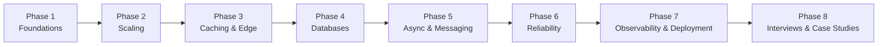
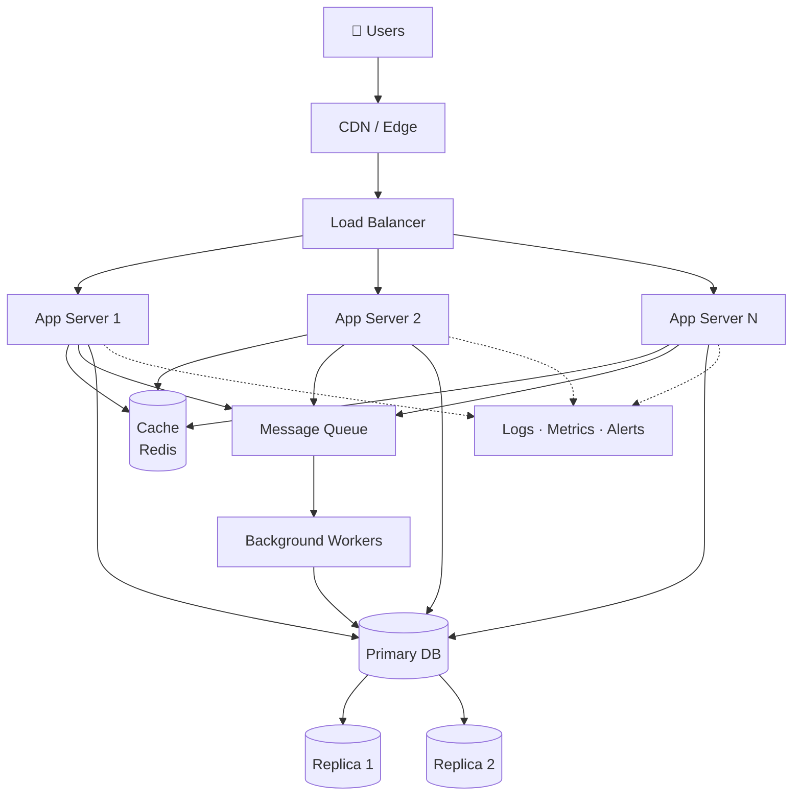
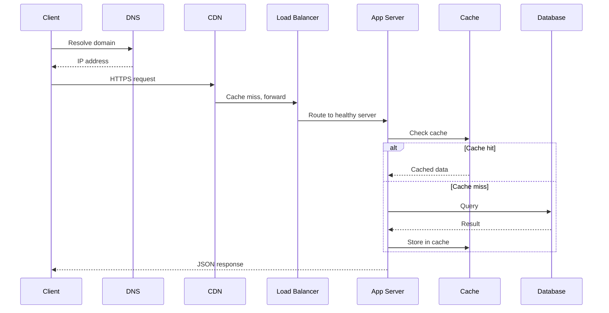
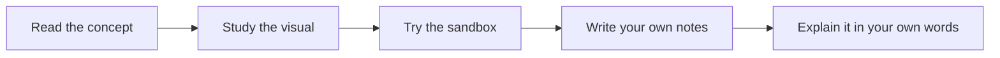
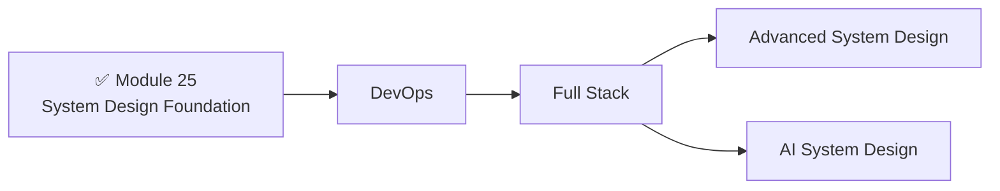

# 🏗️ System Design Foundation

> Part of the [**AI Zero to Hero**](https://github.com/Sheharyar-Sarmad/ai-zero-to-hero) series, **Module 25**.

Learn how real-world systems are built: how a request travels across the internet, how servers scale, how data is stored and cached, and how large systems stay reliable under pressure.

---

## 📌 About This Module

This is the **first step** into system design in the AI Zero to Hero journey. I started my own system design learning with the excellent free resource below, and this module follows its structure.

### 🌐 Main Resource

**[freesystemdesign.com](https://freesystemdesign.com/)**

The site covers:

- **46 concepts** explained step by step
- **16 interactive sandboxes** to practice hands-on
- **Visual explanations** for every topic
- **8 phases**, from the basics to full interview case studies

> 💡 **Philosophy:** There is no need to rebuild everything from scratch. When a great open resource already exists, the best move is to learn from it, build on it, and give it credit. This repo focuses on open-source learning and on practicing what you read.

For now, these **46 concepts, 16 sandboxes, visuals and 8 phases are more than enough** as a strong foundation. I'll be building out the rest of the course myself over time.

---

## ✅ Prerequisites

You only need **basic backend knowledge**:

- What a server and a client are
- How HTTP requests and responses work
- Basic idea of APIs and databases
- Comfort reading simple code in any language

New to this? Start from the beginning of the series: **[ai-zero-to-hero](https://github.com/Sheharyar-Sarmad/ai-zero-to-hero)**.

---

## 🗺️ Learning Roadmap

---

## 📚 Concepts Covered (46)

### Phase 1 — Foundations
1. Anatomy of a Web Request
2. HTTP
3. APIs & JSON
4. Latency vs Throughput

### Phase 2 — Scaling
5. Stateless Servers
6. Sync vs Async
7. Load Balancer
8. Horizontal vs Vertical Scaling
9. Load Balancing Algorithms
10. Health Checks
11. Auto-scaling
12. Session Management

### Phase 3 — Caching & Edge
13. CDN
14. Edge Computing
15. Why Caches Exist
16. Cache
17. Write-Through vs Write-Back
18. Cache Invalidation
19. Multi-Tier Caching

### Phase 4 — Databases
20. SQL vs NoSQL
21. Database Indexes
22. Database Replication
23. Sharding
24. Consistent Hashing
25. ACID Transactions
26. Eventual Consistency

### Phase 5 — Async & Messaging
27. Message Queue
28. Pub/Sub
29. Event-Driven Architecture
30. WebSockets
31. Webhooks

### Phase 6 — Reliability
32. Rate Limiting
33. Single Point of Failure
34. Failover
35. Circuit Breaker
36. Retries & Backoff
37. Idempotency
38. Disaster Recovery

### Phase 7 — Observability & Deployment
39. Logging
40. Metrics & Alerting
41. Containers
42. CI/CD

### Phase 8 — Interviews & Case Studies
43. How to Crack a System Design Interview
44. Design a URL Shortener
45. Design a News Feed
46. Design YouTube

---

## 🧩 Big Picture: A Typical Scalable System

This is the kind of architecture you will be able to read and design by the end of the module.

---

## 🔄 Anatomy of a Web Request

---

## 🧪 Hands-On Practice

The resource includes **16 interactive sandboxes** where you can experiment with concepts such as load balancing, caching strategies, rate limiting, sharding and more, instead of just reading about them.

**Suggested workflow for each concept:**

---

## 🔭 What's Next

This module is the **foundation**. In future modules, after **DevOps** and **Full Stack**, we will cover:

- 🔜 **Advanced System Design:** distributed systems, consensus, large-scale architectures
- 🔜 **AI System Design:** serving LLMs, vector databases, RAG pipelines, inference scaling, ML infrastructure

---

## 🤝 Credits

- **Main resource:** [freesystemdesign.com](https://freesystemdesign.com/). All credit for the lessons, visuals and sandboxes goes to its creators.
- **Course series:** [AI Zero to Hero](https://github.com/Sheharyar-Sarmad/ai-zero-to-hero) by [Sheharyar Sarmad](https://github.com/Sheharyar-Sarmad)

---

## ⭐ Support

If this module helps you, consider giving the [main repo](https://github.com/Sheharyar-Sarmad/ai-zero-to-hero) a star and sharing it with others who are learning.

**Happy learning! 🚀**