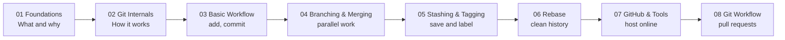
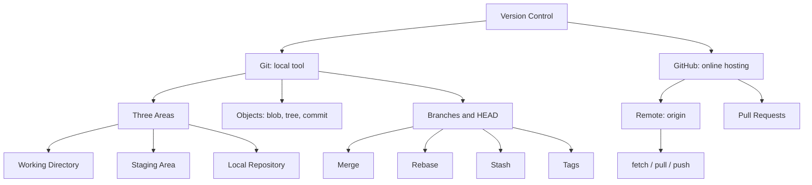
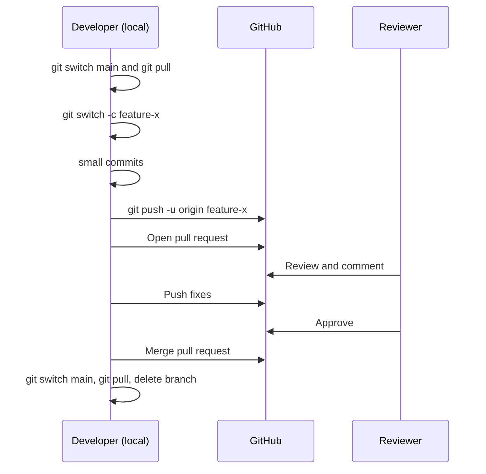

# Git & GitHub

> Part of the [AI Zero to Hero](https://github.com/Sheharyar-Sarmad/ai-zero-to-hero) course.
> Learn version control from first principles to a professional pull request workflow.


---

## Why This Module Matters

Every AI and software project changes constantly: code, notebooks, configs, datasets, experiments. Git lets you **track every change, undo mistakes, experiment safely, and collaborate**. GitHub lets you **back up, share, and review** that work online.

By the end of this module you will be able to:

- Explain what Git is and how it differs from GitHub.
- Understand the working directory, staging area, and repository.
- Create commits, branches, merges, stashes, tags, and rebases.
- Resolve merge conflicts confidently.
- Host a project on GitHub and connect it from Git Bash, VS Code, or GitHub Desktop.
- Follow the modern feature-branch + pull request workflow used by professional teams.

---

## Module Architecture

### 1. Learning Path



### 2. Concept Map



### 3. Data Flow (How a Change Travels)

```text
 Working Directory      Staging Area        Local Repository         GitHub (origin)
 (files you edit)  -->  (next snapshot) --> (.git history)      -->  (remote copy)
        |   git add            |  git commit        |     git push          |
        |                                                                   |
        +<------------------------ git pull (fetch + merge) ----------------+
```

### 4. Branch and Merge Model

```text
main      o-----o-----o-----------------o   <- stable, always working
                       \               /
feature                 o---o---o---o       <- small commits, then a pull request
```

### 5. Professional Workflow



---

## Folder Structure

```text
26_git_github/
|
|-- 01_foundations/
|   |-- 01_introduction.md
|   |-- 02_what_is_git.md
|   |-- 03_history_of_git.md
|   |-- 04_centralized_vs_distributed_vcs.md
|   |-- 05_git_vs_github.md
|   `-- 06_installing_git.md
|
|-- 02_git_internals/
|   |-- 01_how_git_works.md
|   |-- 02_working_directory_staging_repository.md
|   |-- 03_git_objects_and_commits.md
|   |-- 04_git_ignore.md
|   `-- 04_git_keep.md
|
|-- 03_basic_git_workflow/
|   `-- 01_basic_git_workflow.md
|
|-- 04_branching_and_merging/
|   |-- 01_branching.md
|   `-- 02_merge_conflicts.md
|
|-- 05_stashing_and_taging/
|   |-- 01_git_stashing.md
|   `-- 02_git_taging.md
|
|-- 06_git_rebase/
|   `-- 01_rebase_basics.md
|
|-- 07_github_and_tools/
|   |-- 01_hosting_repositories_on_github.md
|   `-- 02_github_desktop_and_vscode.md
|
|-- 08_git_workflow/
|   `-- 01_modern_git_workflow.md
|
|-- cheet_sheet.pdf
`-- README.md
```

---

## Lessons Overview

| # | Section | Lesson | What You Learn |
|---|---|---|---|
| 01 | Foundations | Introduction | Why version control exists |
| | | What is Git | Snapshots, history, undo |
| | | History of Git | Created by Linus Torvalds in 2005 |
| | | Centralized vs Distributed | Why Git gives everyone a full copy |
| | | Git vs GitHub | Tool vs hosting platform |
| | | Installing Git | Install, `git config`, first setup |
| 02 | Git Internals | How Git Works | The big picture |
| | | Working Directory, Staging, Repository | The three areas |
| | | Objects and Commits | Blob, tree, commit, SHA, HEAD |
| | | `.gitignore` | Files Git should never track |
| | | `.gitkeep` | Keeping empty folders |
| 03 | Basic Workflow | Basic Git Workflow | `init`, `add`, `commit`, `status`, `log` |
| 04 | Branching and Merging | Branching | `branch`, `switch`, `merge` |
| | | Merge Conflicts | Reading markers and resolving |
| 05 | Stashing and Tagging | Stashing | Shelve unfinished work |
| | | Tagging | Label releases like `v1.0.0` |
| 06 | Rebase | Rebase Basics | Linear history, the golden rule |
| 07 | GitHub and Tools | Hosting on GitHub | Account, remote, `push`, `pull`, `fetch` |
| | | GitHub Desktop and VS Code | GUI equivalents of commands |
| 08 | Git Workflow | Modern Git Workflow | Feature branch, pull request, merge |

---

## Quick Start

```bash
# One-time setup
git config --global user.name "Your Name"
git config --global user.email "you@example.com"
git config --global init.defaultBranch main

# Start a project and publish it
git init
git add .
git commit -m "Initial commit"
git remote add origin https://github.com/your-username/my-project.git
git branch -M main
git push -u origin main
```

---

## Essential Commands

| Goal | Command |
|---|---|
| Check state | `git status` |
| Stage changes | `git add <file>` or `git add .` |
| Save a snapshot | `git commit -m "message"` |
| View history | `git log --oneline --graph --all` |
| New branch | `git switch -c <name>` |
| Merge | `git merge <branch>` |
| Shelve work | `git stash` / `git stash pop` |
| Tag a release | `git tag -a v1.0.0 -m "Release 1.0"` |
| Download only | `git fetch` |
| Download and update | `git pull` |
| Upload | `git push` |

The full list with explanations is in [`cheet_sheet.pdf`](./cheet_sheet.pdf).

---

## Recommended Study Order

1. Read the sections in numeric order, **01 to 08**.
2. Type every command yourself in a practice repository. Do not only read.
3. After sections 03 and 04, deliberately create and fix a merge conflict.
4. After section 07, publish a practice repository to GitHub.
5. Finish with section 08: make a feature branch and open your own pull request.

---

## Practice Checklist

- [ ] Installed Git and ran `git --version`
- [ ] Configured name and email
- [ ] Created a GitHub account at [github.com](https://github.com)
- [ ] Made a repository with at least 3 commits
- [ ] Created, switched, and merged a branch
- [ ] Resolved a merge conflict
- [ ] Used `git stash` and `git stash pop`
- [ ] Created an annotated tag
- [ ] Pushed a project to GitHub
- [ ] Opened and merged a pull request, then deleted the branch

---

## Prerequisites

- A computer with a terminal (Git Bash on Windows, Terminal on macOS/Linux)
- A code editor such as [VS Code](https://code.visualstudio.com)
- No prior Git knowledge required

---

## Navigation

- Back to the main course: [AI Zero to Hero](https://github.com/Sheharyar-Sarmad/ai-zero-to-hero)
- This module: [26_git_github](https://github.com/Sheharyar-Sarmad/ai-zero-to-hero/tree/main/26_git_github)

---

## Author

**Sheharyar Sarmad**

- LinkedIn: [sheharyar-sarmad](https://www.linkedin.com/in/sheharyar-sarmad-9b7736289/)
- GitHub: [Sheharyar-Sarmad](https://github.com/Sheharyar-Sarmad)

If this module helped you, consider starring the repository.