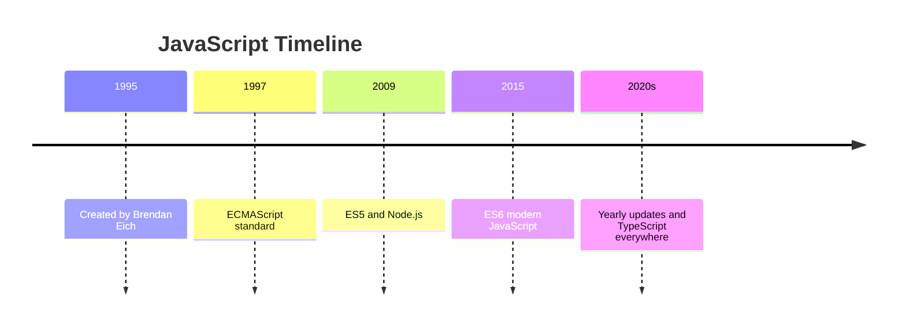
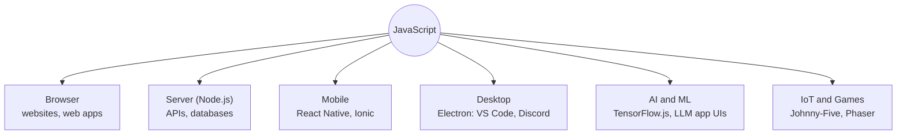
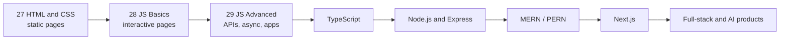

# 🚀 Why JavaScript?

> **Module 28 · JS Basics · 01_foundation** of my [AI Zero to Hero](https://github.com/Sheharyar-Sarmad/ai-zero-to-hero) roadmap.

---


## 1.1 The Problem JavaScript Solved

In the early 1990s, web pages were **static documents**. HTML described content, later CSS styled it, but nothing could **react**. A form could not check your email before sending it, a menu could not open, a page could not update without a full reload.

Netscape needed a small scripting language that ran **inside the browser** so ordinary people could make pages interactive.

```
 1993-94                    1995                         Today
+-----------+          +--------------+          +------------------+
| Static    |  -----> | JavaScript   |  -----> | Interactive apps |
| HTML pages|          | born inside  |          | Gmail, Netflix,  |
| (read-only)|         | the browser  |          | Figma, ChatGPT UI|
+-----------+          +--------------+          +------------------+
```

## 1.2 A Short History

| Year | Event |
|------|-------|
| **1995** | **Brendan Eich** creates the language at Netscape in about **10 days**. Names: *Mocha*, then *LiveScript*, finally **JavaScript** (a marketing decision) |
| **1996** | Microsoft ships its own version (JScript) in Internet Explorer, creating chaos between browsers |
| **1997** | **ECMAScript (ES1)** standard created by ECMA International so every browser follows the same rules |
| **2009** | **ES5** arrives. Also **Node.js** is released: JavaScript now runs **outside** the browser |
| **2015** | **ES6 / ES2015**, the biggest upgrade: `let`, `const`, arrow functions, classes, promises, modules |
| **2015+** | A new ECMAScript version **every year** (async/await, optional chaining, and more) |
| **Now** | The most widely used programming language for the web, with `TypeScript` layered on top |

> 💡 **JavaScript is the language. ECMAScript is the specification (the rulebook) that the language follows.**



## 1.3 JavaScript is NOT Java

This is the most common beginner confusion.

| | **Java** | **JavaScript** |
|---|---|---|
| Created for | Enterprise apps, Android | Making web pages interactive |
| Typing | Statically typed | Dynamically typed |
| Runs on | JVM (Java Virtual Machine) | Browser engines, Node.js |
| Compiled? | Compiled to bytecode first | Interpreted / JIT compiled |
| Relation | Completely different language | The name was borrowed for marketing |

> 🧠 *"Java is to JavaScript as car is to carpet."*

## 1.4 Where Does JavaScript Run?

JavaScript started in the browser but now runs almost **everywhere**.



## 1.5 Why Learn JavaScript? (The Real Reasons)

1. **It is the only language browsers run natively.** HTML and CSS cannot think; JavaScript can. If you want to build for the web, you must know it.
2. **One language for the full stack.** Frontend (React, Next.js) and backend (Node.js, Express) can both be JavaScript or TypeScript.
3. **Huge ecosystem.** `npm` is the largest package registry in the world: millions of ready-made libraries.
4. **Great for AI-era products.** Every AI app (chatbots, dashboards, agents) needs an interface and an API layer, and most of those are built in JavaScript / TypeScript.
5. **Beginner friendly.** You need no installation to start: your browser already has a JavaScript console.
6. **Massive job market and community.** Countless tutorials, answers, and open-source projects.
7. **Gateway to TypeScript.** TypeScript is just JavaScript with types, so JS knowledge transfers directly.

## 1.6 The Three Pillars Revisited

```
          +----------------------------------------------+
          |                  A WEBSITE                   |
          +----------------------------------------------+
               |                |                |
        +------v-----+   +------v-----+   +------v-----+
        |    HTML    |   |    CSS     |   | JavaScript |
        |  Skeleton  |   |  Skin and  |   |  Brain and |
        | (structure)|   |   clothes  |   |   muscles  |
        +------------+   +------------+   +------------+
         "This is a       "Make it         "When the user
          button"          orange"          clicks, do X"
```

**How they cooperate on one button:** HTML says *"here is a button"*, CSS says *"make it orange and rounded"*, and JavaScript says *"when it is clicked, show a message"*. Remove any one pillar and the experience breaks.

```
  User clicks the button
          |
          v
  JavaScript listens for the click  --->  runs the reaction
          |                                    |
          v                                    v
  HTML element receives the event      CSS/HTML update on screen
```

## 1.7 What Can You Build With JavaScript?

| Category | Examples |
|----------|----------|
| Websites and web apps | Portfolios, dashboards, e-commerce, social platforms |
| Interactive UI | Sliders, modals, dark mode, form validation, animations |
| Backend / APIs | REST APIs, real-time chat servers, authentication |
| Mobile apps | Cross-platform iOS and Android apps |
| Desktop apps | Code editors, chat apps, design tools |
| Games | Browser games with Canvas / Phaser |
| AI interfaces | Chat UIs, streaming responses, agent dashboards |

## 1.8 Honest Pros and Cons

| ✅ Strengths | ⚠️ Weaknesses |
|-------------|---------------|
| Runs everywhere, nothing to install | Dynamic typing can hide bugs (fixed by TypeScript) |
| Gigantic ecosystem and community | Quirky behaviour (`"5" + 1` is `"51"`) |
| Fast thanks to modern engines (JIT) | Single-threaded: heavy computation can freeze the page |
| Same language frontend + backend | Ecosystem moves fast and can feel overwhelming |
| Very quick to prototype | Easy to write messy code without discipline |

## 1.9 Where JavaScript Sits in My Roadmap



---

## ✍️ Exercises

- [ ] Explain in 3 sentences why browsers need JavaScript on top of HTML and CSS.
- [ ] List 5 places JavaScript can run, with one real example of each.
- [ ] Write the difference between **JavaScript** and **ECMAScript** in your own words.
- [ ] Find 3 websites you use daily and guess which parts are JavaScript.

---

## ➡️ Next

**[02_intro_to_js.md](./02_intro_to_js.md)**: what JavaScript is, how to run it, first programs.