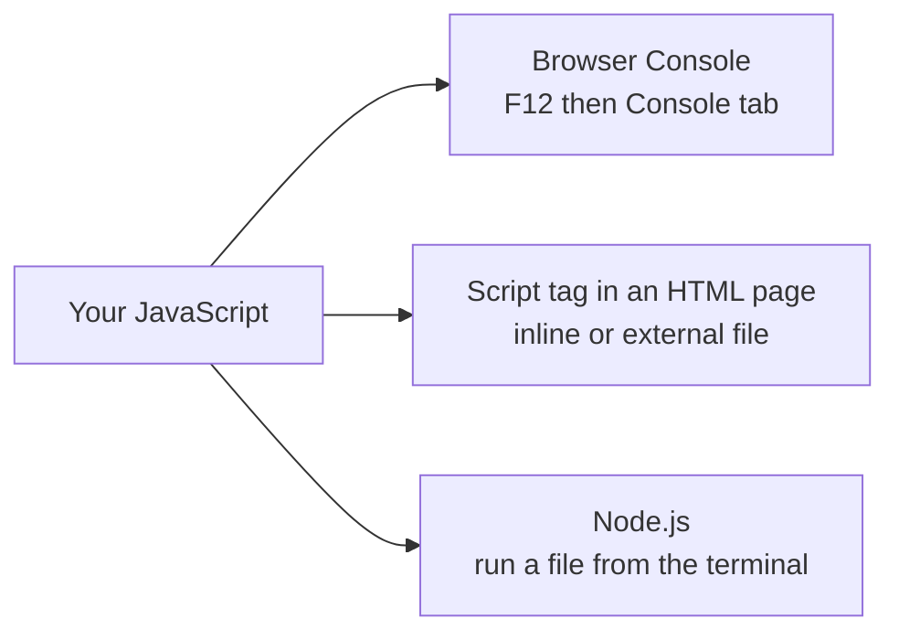
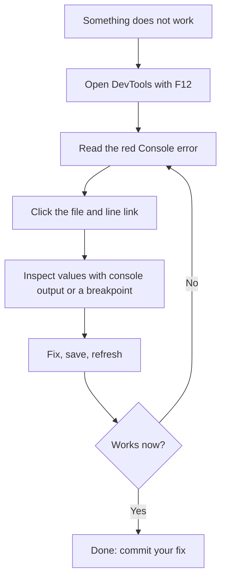

# 🧩 Introduction to JavaScript

> **Module 28 · JS Basics · 01_foundation** of my [AI Zero to Hero](https://github.com/Sheharyar-Sarmad/ai-zero-to-hero) roadmap.

---

## 2.1 What Is JavaScript?

> **JavaScript is a high-level, dynamically typed, multi-paradigm, interpreted (JIT-compiled) programming language that makes web pages interactive.**

Let us unpack every word:

| Term | Meaning |
|------|---------|
| **High-level** | You write human-readable instructions; you do not manage memory or CPU details yourself |
| **Dynamically typed** | Variables have no fixed type; the type belongs to the **value** and can change over time |
| **Multi-paradigm** | Supports procedural, object-oriented and functional styles in the same language |
| **Interpreted / JIT** | Code runs without a separate manual compile step; engines compile frequently used code to machine code on the fly |
| **Single-threaded** | One thing executes at a time (waiting is handled by the event loop, see [03_how_it_works.md](./03_how_it_works.md)) |
| **Event-driven** | Code reacts to events: clicks, key presses, network responses, timers |
| **Garbage collected** | The engine frees memory you no longer use |

```
                 JavaScript
                     |
   +-----------+-----+------+-------------+
   |           |            |             |
High-level  Dynamic     Multi-paradigm  Event-driven
 (readable)  typing    (OOP+functional)  (reacts to
                                          the user)
```

## 2.2 The Ways to Run JavaScript

There is no single place JavaScript lives. The same language can be executed by several hosts.



| Method | What it is | Best for | Drawback |
|--------|-----------|----------|----------|
| **Browser console** | An interactive prompt inside DevTools (`F12`) | Experiments, testing one idea, learning | Nothing is saved |
| **Inline script** | JavaScript written between script tags inside the HTML file | Tiny demos | Mixes structure and behaviour, hard to maintain |
| **External file** ✅ | A separate `.js` file connected with a script tag | **Every real project** | Needs correct file path |
| **Node.js** | Runs JavaScript outside the browser, in the terminal | Backend, tools, scripts | No page (`document`) available |

> ✅ **Best practice:** keep HTML, CSS and JavaScript in **separate files**. It is the same separation of concerns you used in the HTML/CSS module.

## 2.3 Where the Script Tag Goes (Loading Strategies)

The browser reads HTML top to bottom. A normal script **pauses HTML parsing** while it downloads and runs, so *where* and *how* you load it matters.

```
Normal script in the head:
HTML parsing   |=====|  PAUSED  |==========|
Script         |------download------|--run--|
                              (page is blocked)

Script with "defer":
HTML parsing   |=======================|
Script         |------download------|        |--run after parsing--|

Script with "async":
HTML parsing   |=====|  PAUSED  |=========|
Script         |--download--|--run--|
                  (runs the moment it arrives, order not guaranteed)
```

| Option | Downloads | Runs | Keeps order? | Use for |
|--------|-----------|------|--------------|---------|
| *(plain)* in head | Blocking | Immediately | Yes | Avoid |
| **`defer`** | In parallel | **After the HTML is parsed** | **Yes** | **Your own scripts (default choice)** |
| `async` | In parallel | As soon as ready | No | Independent scripts such as analytics |
| End of `<body>` | After all HTML above | Immediately | Yes | The classic older approach |

> 🧠 **Why scripts break:** if a script runs *before* the element it wants exists, it finds nothing (`null`). `defer` fixes this by waiting for the HTML.

## 2.4 Talking to the User and the Page

JavaScript has built-in ways to show information, receive input and change the page.

```
          +----------------------+
 You ---> |  JavaScript program  | ---> Output channels
          +----------------------+
            ^                |
            |                +--> console (for developers)
   Input channels            +--> popup dialogs (alert)
   - prompt dialog           +--> the page itself (change text, colours)
   - form fields
   - clicks and keys
```

| Tool | Audience | Purpose | Used in real apps? |
|------|----------|---------|--------------------|
| `console.log` | **Developer** | Print values while debugging | Yes (development only) |
| `alert` | User | Popup message that blocks the page | Rarely |
| `prompt` | User | Popup asking for one text value | Rarely |
| **DOM changes** | User | Update text, styles, elements on the page | **Constantly** |

### Useful console methods

| Method | What it does | Looks like |
|--------|--------------|-----------|
| `console.log` | Normal message | Plain text |
| `console.info` | Informational message | Plain / blue icon |
| `console.warn` | Warning | Yellow |
| `console.error` | Error message | Red |
| `console.table` | Shows arrays/objects as a table | Grid |
| `console.group` | Indents related messages together | Nested |
| `console.time` | Measures how long something takes | Milliseconds |

## 2.5 Language Fundamentals at a Glance

### Statements, semicolons and comments

```
 Program
   |
   +-- Statement 1   (one complete instruction)   ;
   +-- Statement 2                                 ;
   +-- Statement 3                                 ;

 Comments are notes for humans. The engine ignores them:
   - single-line comment  (starts with two slashes)
   - multi-line comment   (wrapped in slash-star ... star-slash)
```

- A **statement** is one instruction. Ending it with a semicolon is recommended, even though the engine can often insert them for you (automatic semicolon insertion can cause surprises).
- **Comments** explain *why*, not *what*. Good code explains itself; comments explain decisions.

### Case sensitivity

JavaScript treats upper and lower case as **different letters**: a name written as `userName` and another written as `username` are two separate variables. Most beginner bugs of the type "variable is not defined" are just capitalisation typos.

### Naming rules and conventions

| Rule | Good | Bad |
|------|------|-----|
| Start with a letter, `_` or `$` | `score`, `_id`, `$el` | `1score` |
| No spaces or hyphens | `firstName` | `first name`, `first-name` |
| Not a reserved word | `total` | `let`, `class`, `return` |
| Use **camelCase** | `totalPrice` | `Total_price` |
| Be descriptive | `isLoggedIn` | `x`, `flag1` |

### Dynamic typing

In a **statically typed** language (Java, C++) you declare the type and it can never change. JavaScript decides the type **from the value**, and the same variable may hold different types over time.

```
 STATIC TYPING (Java)                DYNAMIC TYPING (JavaScript)
+-------------------+               +-------------------------+
| box labelled      |               | box with NO label       |
| "number"          |               |                         |
| only numbers fit  |               | anything fits, the      |
+-------------------+               | VALUE carries the type  |
                                    +-------------------------+
 Error caught BEFORE running         Error may appear WHILE running
```

| Advantage | Disadvantage |
|-----------|--------------|
| Fast to write, flexible | Type mistakes only show up at runtime |
| Less boilerplate | Harder to maintain big codebases (TypeScript solves this) |

### The 8 data types (preview)

```
                    JavaScript values
                          |
         +----------------+------------------+
         |                                   |
    PRIMITIVES (7)                       OBJECTS (1 family)
 string   number   bigint                object, array,
 boolean  undefined  null  symbol        function, date ...
```

| Type | Represents | Example idea |
|------|-----------|--------------|
| `string` | Text | A name |
| `number` | Integers and decimals | A price |
| `bigint` | Very large integers | Huge IDs |
| `boolean` | True or false | Is logged in? |
| `undefined` | "No value assigned yet" | Declared, not filled |
| `null` | "Intentionally empty" | Cleared on purpose |
| `symbol` | A guaranteed-unique identifier | Hidden keys |
| `object` | Collections of values and behaviour | Arrays, functions, dates |

> ⚠️ **Historic bug:** asking for the type of `null` returns `"object"`. This mistake existed in the very first version of JavaScript and can never be fixed without breaking old websites. `null` is really a primitive.

### JavaScript's famous quirks

Understanding *why* these happen means they never surprise you again.

| Situation | Result | Why it happens |
|-----------|--------|----------------|
| Text `"5"` plus number `1` | Text `"51"` | `+` prefers **joining text** if either side is text |
| Text `"5"` minus number `1` | Number `4` | `-` only does maths, so text is **converted** to a number |
| `0.1 + 0.2` | `0.30000000000000004` | Decimal fractions cannot be stored exactly in binary (same in every language) |
| Empty array plus empty array | Empty text | Both are converted to text first, then joined |
| `null == undefined` | `true` | **Loose** equality converts types |
| `null === undefined` | `false` | **Strict** equality compares type **and** value |

```
 Loose equality  ==   : "try to make them the same type first"   (surprising)
 Strict equality ===  : "same type AND same value?"              (predictable)

                 ✅ Always prefer strict equality
```

## 2.6 Strict Mode

**Strict mode** is an opt-in set of stricter rules that turns silent mistakes into visible errors.

| Without strict mode | With strict mode |
|---------------------|------------------|
| Using an undeclared variable silently creates a global one | Throws a `ReferenceError` |
| Duplicate parameter names allowed | Not allowed |
| Some silent failures are ignored | They throw errors |

Modern code written with **classes and ES modules** is strict automatically, and using `let` and `const` avoids most of the old problems anyway.

## 2.7 Debugging Basics



### The four most common error types

| Error | Meaning | Typical cause |
|-------|---------|---------------|
| `ReferenceError` | A name does not exist | Typo, wrong scope, used before declared |
| `TypeError` | A value is used in a way its type does not allow | Calling something that is not a function, reading a property of `undefined` |
| `SyntaxError` | The code structure is invalid | Missing bracket, quote or comma |
| `RangeError` | A value is outside the allowed range | Infinite recursion, invalid array length |

> 💡 **Reading an error:** the message says **what** went wrong, and the link beside it says **where** (file and line number). Always read the first line first.

## 2.8 Common Beginner Mistakes

| Mistake | Why it happens | Fix |
|---------|----------------|-----|
| Script runs before the element exists (`null`) | Script loaded too early | Use `defer` or place the script at the end of the body |
| Using `=` instead of `===` | `=` **assigns**, `===` **compares** | Learn the difference by heart |
| Forgetting quotes around text | Engine thinks it is a variable name | Wrap text in quotes |
| Mixing up `console.log` and `alert` | Both "show" something | Use the console for debugging |
| Wrong file path to the script | Typo or wrong folder | Check the Network tab for a 404 |
| Never opening the Console | Errors stay invisible | Press `F12` and read the red messages |

---

## ✍️ Exercises

- [ ] Explain each word in "high-level, dynamically typed, multi-paradigm, JIT, single-threaded, event-driven" in your own words.
- [ ] Draw the three script-loading timelines (plain, `defer`, `async`) on paper and explain which one you will use and why.
- [ ] Make a table of the 8 data types with one real-life analogy for each.
- [ ] Explain why `"5" + 1` and `"5" - 1` give different results.
- [ ] Explain the difference between `==` and `===` and when each could surprise you.
- [ ] List the four error types and one realistic cause of each.
- [ ] Draw the debugging flowchart from memory.

---

## ⬅️ Previous · ➡️ Next

**[01_why_js.md](./01_why_js.md)** · **[03_how_it_works.md](./03_how_it_works.md)**: how JavaScript really runs under the hood.