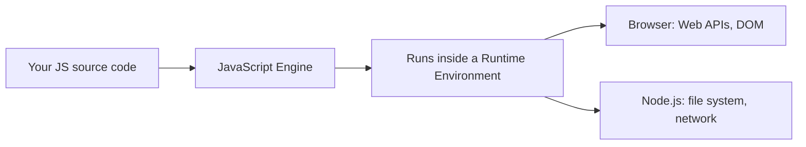
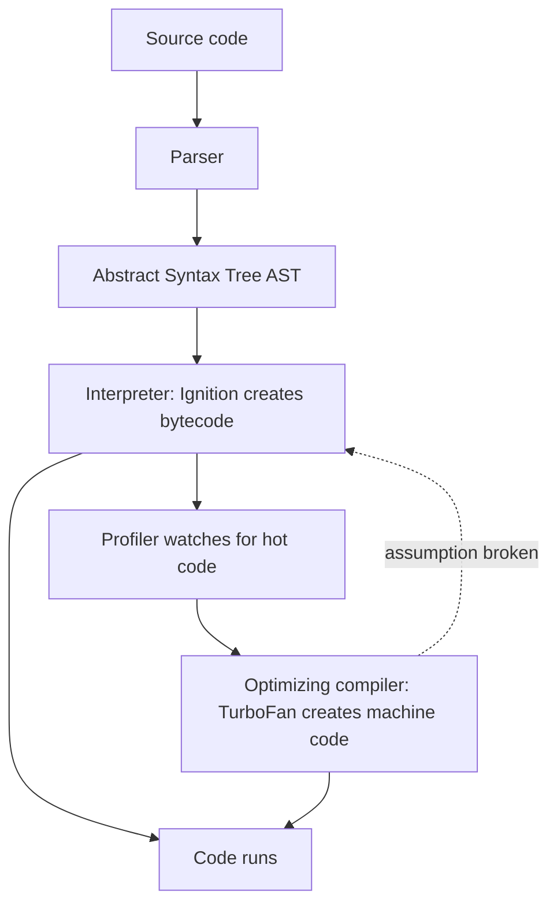
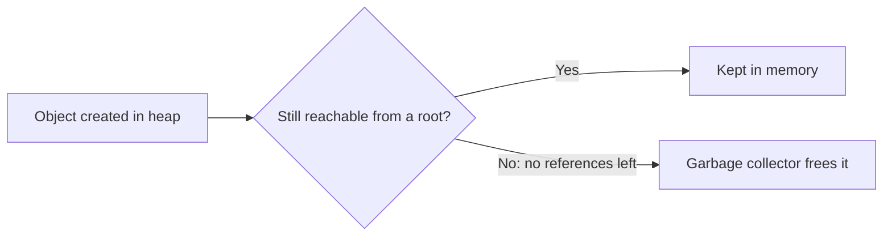
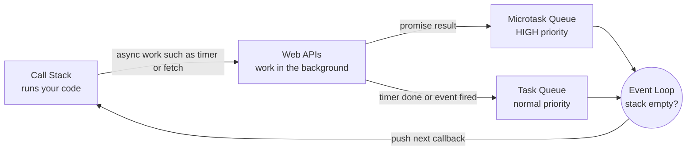
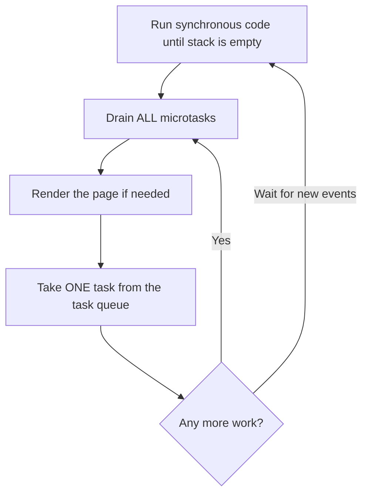
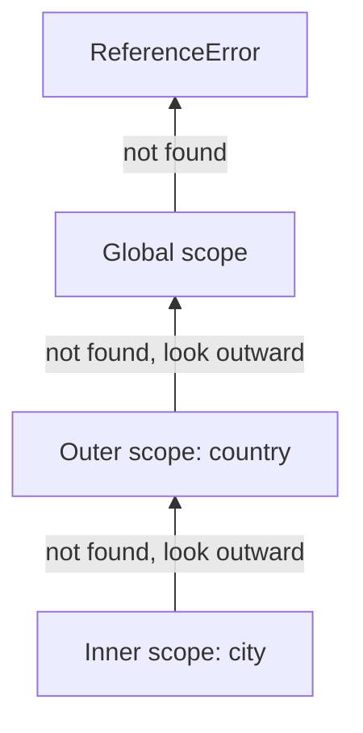
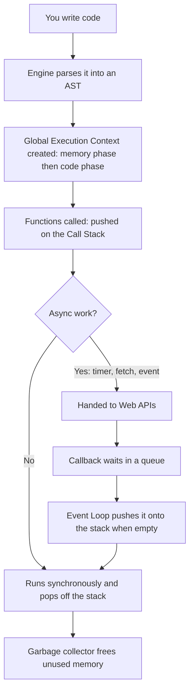

# ⚙️ How JavaScript Works Internally

> **Module 28 · JS Basics · 01_foundation** of my [AI Zero to Hero](https://github.com/Sheharyar-Sarmad/ai-zero-to-hero) roadmap.
> This is the part that separates people who **copy** JavaScript from people who **understand** it.

---

## 3.1 The Big Picture

Your computer's CPU only understands machine code (0s and 1s). So who runs a `.js` file? The **JavaScript engine**.



| Environment | Engine | Used by |
|-------------|--------|---------|
| Chrome, Edge, Brave, Node.js, Deno | **V8** (Google) | Most of the web |
| Firefox | **SpiderMonkey** (Mozilla) | The very first JS engine |
| Safari | **JavaScriptCore** (Apple) | iOS and macOS |

> 🧠 **Engine ≠ Runtime.** The engine executes the JavaScript language itself. The runtime (browser or Node) *adds extra features around it*: `document`, `setTimeout`, `fetch`, `fs`. Those are **not part of JavaScript**; the environment provides them.

```
+---------------------- RUNTIME (browser or Node) ----------------------+
|                                                                       |
|   +---------------------+        +--------------------------------+   |
|   |    JS ENGINE        |        |  EXTRA FEATURES (not JS itself)|   |
|   |  - runs your code   |        |  Browser: DOM, fetch, timers   |   |
|   |  - manages memory   |        |  Node: files, network, OS      |   |
|   +---------------------+        +--------------------------------+   |
+-----------------------------------------------------------------------+
```

## 3.2 Inside the Engine: From Text to Machine Code

```
 Source code
     |
     v
+------------+   +---------+   +----------------+   +------------------+
|   PARSER   |-->|   AST   |-->|  INTERPRETER   |-->|     BYTECODE     |
| reads text |   | tree of |   | (V8: Ignition) |   | runs immediately |
| checks     |   | your    |   +----------------+   +------------------+
| syntax     |   | code    |            |                    |
+------------+   +---------+     profiler spots "hot" code    |
                                        v                    |
                              +-------------------+          |
                              |  OPTIMIZING JIT   |<---------+
                              | (V8: TurboFan)    |
                              | machine code, fast|
                              +-------------------+
                                        |
                       if an assumption breaks: DEOPTIMIZE
                       (fall back to bytecode)
```



**Step by step:**

1. **Parsing:** the engine reads your code, checks syntax (a missing bracket throws a `SyntaxError` *before anything runs*) and builds an **AST**, a tree describing your program.
2. **Interpretation:** the interpreter turns the AST into **bytecode** and starts running it right away (fast startup).
3. **Profiling:** while running, the engine watches which functions run many times ("hot" code).
4. **JIT compilation:** hot code is compiled into optimised **machine code** for speed.
5. **Deoptimization:** if an assumption was wrong (for example a value that was always a number suddenly becomes text), the engine throws the optimised version away and returns to bytecode.

> This mix of interpreting and compiling at runtime is called **JIT (Just-In-Time) compilation**, and it is why modern JavaScript is surprisingly fast.

### What an AST looks like

For the single instruction *"create a variable named total and store 5 + 3 in it"* the engine builds this tree:

```
VariableDeclaration (let)
 `-- VariableDeclarator
      |-- Identifier: total
      `-- BinaryExpression (+)
           |-- Literal: 5
           `-- Literal: 3
```

Tip: explore real ASTs at **astexplorer.net**.

## 3.3 Memory: Stack and Heap

The engine uses two places to store data.

```
+---------------- CALL STACK -----------------+   +---------------- MEMORY HEAP ----------------+
| Tracks WHAT IS RUNNING and holds            |   | Large, unstructured area for objects,      |
| small, simple values and references         |   | arrays and functions                       |
|                                             |   |                                            |
|  age   = 25            (value itself)       |   |   { name: "Ali", skills: [...] }  <-+      |
|  user  = reference ----------------------------->                                     |      |
+---------------------------------------------+   +--------------------------------------------+
```

### Copy by value vs copy by reference

| | **Primitives** (number, string, boolean...) | **Objects** (object, array, function...) |
|---|---|---|
| Stored | The value itself | A **reference (address)** to the heap |
| Copying | Creates an **independent copy** | Copies the **address**: both names point to the same object |
| Change one copy | The other is **unaffected** | The other **sees the change** |

```
PRIMITIVE copy                     OBJECT copy
 a = 10                             obj1 ---+
 b = a   (b gets its own 10)                |--->  { score: 1 }   one object in the heap
 b = 20  -> a is still 10           obj2 ---+
                                    change via obj2  ->  obj1 sees it too
```

### Garbage collection (automatic memory cleanup)

JavaScript frees memory for you using **mark-and-sweep**: starting from roots (global variables and the current stack) it **marks** everything still reachable and **sweeps** away the rest.

```
Before:   root -> A -> B          C   D        (C and D unreachable)
Mark:     root -> A -> B   (marked)   C   D
Sweep:    root -> A -> B              (C and D freed)
```



> ⚠️ **Memory leaks** happen when you keep references you no longer need: forgotten timers, giant global lists, event listeners that were never removed.

## 3.4 Execution Context

Every time JavaScript runs code it creates an **execution context**: an environment that holds the variables and tells the engine where it currently is.

| Type | Created when | Count |
|------|--------------|-------|
| **Global Execution Context (GEC)** | The program starts | Exactly one |
| **Function Execution Context (FEC)** | A function is **called** | One per call |

Each execution context is built in **two phases**:

```
                 EXECUTION CONTEXT
      +----------------------------------------+
      | Phase 1: CREATION (memory phase)       |
      |   - create variable environment        |
      |   - var  -> stored as  undefined       |
      |   - function declarations -> stored    |
      |     in full (the whole function)       |
      |   - let/const -> stored but "TDZ"      |
      |   - decide the value of `this`         |
      +----------------------------------------+
      | Phase 2: EXECUTION (code phase)        |
      |   - run line by line                   |
      |   - assign real values                 |
      |   - call functions (new contexts)      |
      +----------------------------------------+
```

### Walkthrough: a tiny program

Imagine a program that (1) stores `10` in a variable `x`, (2) defines a function `add` that adds two numbers, and (3) calls `add(2, 3)` and keeps the answer in `total`.

| Step | What happens |
|------|--------------|
| **Creation** (global) | `x = undefined`, `add = [whole function]`, `total = undefined` |
| **Execution**: line 1 | `x` becomes `10` |
| **Execution**: the call | `add(2, 3)` creates a **new function context**, pushed onto the stack |
| Inside `add`: creation | `a = 2`, `b = 3`, `result = undefined` |
| Inside `add`: execution | `result = 5`, the function returns `5`, its context is **popped off** the stack |
| Back in global | `total = 5` |
| Last step | `5` is printed |

```
 Global context                 Function context (add)
+---------------------+        +------------------------+
| x      = 10         |        | a      = 2             |
| add    = [function] | -----> | b      = 3             |
| total  = 5  <-------+--------+ result = 5  --> return |
+---------------------+ return +------------------------+
```

## 3.5 Hoisting

The creation phase is the reason for **hoisting**: declarations are registered *before* any code runs, so the engine already "knows" the names when execution starts.

| Declaration | Hoisted? | Initial value | Usable before its line? |
|-------------|----------|---------------|--------------------------|
| `var` | Yes | `undefined` | Yes, but you only get `undefined` |
| `let` / `const` | Yes, but in the **TDZ** | uninitialised | ❌ No: `ReferenceError` |
| Function declaration | Yes | the whole function | ✅ Yes |
| Function expression / arrow | Depends on the `var`/`let`/`const` holding it | | ❌ No |

```
 Timeline of a variable declared with var
 |---- creation phase ----|------------ execution phase ------------|
 name registered = undefined    line before declaration: undefined
                                declaration line: real value assigned

 Timeline of a variable declared with let / const
 |---- creation phase ----|------------ execution phase ------------|
 name registered, LOCKED    line before declaration: ❌ error (TDZ)
 (Temporal Dead Zone)       declaration line: unlocked, value assigned
```

> **TDZ (Temporal Dead Zone):** the time between entering a scope and reaching the line where a `let` or `const` is declared. Touching the variable in this zone throws an error, which is **good**: it catches mistakes instead of silently giving `undefined`.

A function stored in a `var` is a common trap: only the **name** is hoisted (as `undefined`), not the function, so calling it early gives *"is not a function"*.

## 3.6 The Call Stack

JavaScript is **single-threaded**: it has **one call stack** and can do **one thing at a time**. The stack is a **LIFO** structure (Last In, First Out) that tracks function calls.

Scenario: `first()` calls `second()`, which calls `third()`. Each prints a message after its inner call returns, so the output order is **third, second, first**.

```
 Step 1        Step 2        Step 3        Step 4        Step 5        Step 6        Step 7
+--------+   +--------+   +--------+   +--------+   +--------+   +--------+   +--------+
|        |   |        |   | third  |   |        |   |        |   |        |   |        |
|        |   | second |   | second |   | second |   |        |   |        |   |        |
| first  |   | first  |   | first  |   | first  |   | first  |   |        |   |        |
|--------|   |--------|   |--------|   |--------|   |--------|   |--------|   |--------|
| global |   | global |   | global |   | global |   | global |   | global |   | global |
+--------+   +--------+   +--------+   +--------+   +--------+   +--------+   +--------+
 first()      second()     third()      third        second       first        done
 called       called       called       prints and   prints and   prints and
                                        pops         pops         pops
```

### Stack overflow

If a function keeps calling itself with **no stopping condition**, frames pile up and never pop off. The stack has a fixed size, so the engine eventually stops with `RangeError: Maximum call stack size exceeded`.

```
 |  fn  |   <- 10,000+ frames later...
 |  fn  |
 |  fn  |      STACK FULL  ->  RangeError
 |  fn  |
 | global|
```

### The problem with one thread

If one task takes a long time (a heavy loop, for example) the stack stays busy and the browser **cannot respond to clicks, scrolling or repainting**. The page "freezes".

```
 Long task on the stack  ===================================>
 Click event waiting     ....................................  (ignored until the stack is free)
 Screen repaint waiting  ....................................  (page looks frozen)
```

So how does JavaScript wait for a timer, a click or a network request **without** freezing? That is the job of the **event loop**.

## 3.7 Asynchronous JavaScript: The Event Loop

JavaScript itself is synchronous and single-threaded. The **runtime** provides helpers that work in the background.

```
+------------------------------ JAVASCRIPT RUNTIME (browser) -------------------------------+
|                                                                                           |
|  +---------------- JS ENGINE ----------------+        +--------- WEB APIs ---------+       |
|  |  +-----------+       +----------------+   |  hand  | timers       fetch         |       |
|  |  | CALL STACK|       |  MEMORY HEAP   |   | -----> | DOM events   geolocation   |       |
|  |  |  (runs    |       |  (objects)     |   | off    | localStorage  ...          |       |
|  |  |   code)   |       +----------------+   |        +-------------+--------------+       |
|  |  +-----^-----+                            |                      | when finished        |
|  +--------|--------------------------------+                       v                      |
|           |                                          +---------------------------+         |
|           |  EVENT LOOP: "is the stack empty?        | MICROTASK QUEUE (priority)|         |
|           |   then take the next task"               |  promise callbacks        |         |
|           +------------------------------------------+---------------------------+         |
|                                                      | CALLBACK (TASK) QUEUE     |         |
|                                                      |  timers, events, I/O      |         |
|                                                      +---------------------------+         |
+-------------------------------------------------------------------------------------------+
```



### The cast of characters

| Part | Role | Analogy (restaurant) |
|------|------|----------------------|
| **Call stack** | Runs the code, one thing at a time | The single waiter |
| **Web APIs** | Do slow work in the background | The kitchen |
| **Microtask queue** | Finished promise callbacks, **high priority** | VIP orders |
| **Task queue** | Finished timers and events, normal priority | Regular orders |
| **Event loop** | Moves callbacks onto the stack when it is empty | The bell that tells the waiter a dish is ready |

### The event loop rules

1. Run **all synchronous code** until the call stack is empty.
2. Run **every microtask** (promise callbacks) until the microtask queue is empty.
3. Render the page if needed.
4. Take **one task** from the task queue (timers, events) and run it.
5. Repeat forever.



### The classic interview question (described in words)

A program does four things in this order:

1. Prints **"1: start"** immediately.
2. Asks the browser to run something after a **timer of 0 milliseconds** and print **"2: timeout"**.
3. Registers a **promise callback** that prints **"3: promise"**.
4. Prints **"4: end"** immediately.

**Actual output order:**

```
1: start
4: end
3: promise
2: timeout
```

**Why?**

| Step | Action | Where it goes |
|------|--------|---------------|
| 1 | Print "start" | Runs now on the stack, prints **1** |
| 2 | Timer of 0 ms | Handed to a Web API; its callback later joins the **task queue** |
| 3 | Promise callback | Goes to the **microtask queue** |
| 4 | Print "end" | Runs now on the stack, prints **4** |
| 5 | Stack is empty, microtasks go first | Prints **3: promise** |
| 6 | Then one task | Prints **2: timeout** |

> ⏱️ A timer of **0 ms does not mean "run now"**. It means "run as soon as the stack is empty **and** all microtasks are done."

### Timeline view

```
Time ------------------------------------------------------------------>

Call stack:   [log 1][timer set][promise set][log 4]   [microtask: log 3]   [task: log 2]
                 |        |           |          |            ^                  ^
                 |        |           +----------+--- queued as microtask        |
                 |        +------ timer finishes, callback queued as task -------+
```

## 3.8 Synchronous vs Asynchronous

| | Synchronous | Asynchronous |
|---|---|---|
| Execution | One step at a time, in order | Starts a task and moves on |
| Blocks the thread? | Yes | No |
| Examples | Loops, maths, printing | Timers, network requests, event listeners, promises |
| Result arrives | Immediately | Later, through a callback |

```
SYNCHRONOUS                          ASYNCHRONOUS
 A ---> B ---> C                      A ---> start slow job ---> C ---> ... ---> job result arrives
 (each waits for the previous)        (does not wait for the slow job)
```

> 🍔 **Restaurant analogy:** a single waiter (the stack) takes your order, gives it to the kitchen (Web APIs) and serves other tables meanwhile. When the kitchen rings the bell, the dish waits in line (queue) until the waiter is free (the event loop).

## 3.9 Scope and the Scope Chain (Preview)

Each execution context knows its **outer** environment. When JavaScript looks for a variable it searches **inside out**, stopping at the first match.

```
Scenario: three nested functions. The innermost one needs a value
that is defined at the global level.

 city scope     { town }                 not found here
    | goes outward
 country scope  { name, city }           not found here
    | goes outward
 global scope   { planet, country }      FOUND ✅
```



This chain is the foundation for **closures**, which you will master in `29_js_advance`.

## 3.10 The Complete Journey of Your Code



---

## ✍️ Exercises

- [ ] Draw the call stack on paper for three nested function calls (`first → second → third`).
- [ ] Draw the full runtime diagram (stack, heap, Web APIs, two queues, event loop) from memory.
- [ ] Explain why a 0 ms timer still runs **after** a promise callback.
- [ ] Explain why a variable declared with `var` reads as `undefined` before its line, but one declared with `let` throws an error.
- [ ] Explain the difference between copying a **primitive** and copying an **object**, using the stack and heap diagram.
- [ ] Explain what causes a **stack overflow** and what a safe function needs to avoid it.
- [ ] Explain the difference between the **engine** and the **runtime** with an analogy of your own.
- [ ] Predict the output order: a program prints "A", sets a 0 ms timer that prints "B", registers a promise callback that prints "C", then prints "D" synchronously.

<details>
<summary>Answer to the last one</summary>

`A`, `D`, `C`, `B`: synchronous code first (`A`, `D`), then the microtask (`C`), then the timer task (`B`).
</details>

---

## 🎤 Interview Questions

<details>
<summary><b>1. Is JavaScript compiled or interpreted?</b></summary>

Both. Modern engines parse the code, interpret it as bytecode, then **JIT-compile** hot code into optimised machine code at runtime.
</details>

<details>
<summary><b>2. Is JavaScript single-threaded? How does it handle async work?</b></summary>

Yes, it has one call stack. Async work is delegated to the runtime (Web APIs), and finished callbacks are queued and pushed back onto the stack by the **event loop** when it is empty.
</details>

<details>
<summary><b>3. What is the call stack?</b></summary>

A LIFO structure that tracks which function is currently running. Each function call pushes a frame; returning pops it.
</details>

<details>
<summary><b>4. What is hoisting?</b></summary>

During the creation phase of an execution context, declarations are registered before code runs. `var` is hoisted as `undefined`, function declarations are fully hoisted, and `let`/`const` are hoisted but unusable until initialised (Temporal Dead Zone).
</details>

<details>
<summary><b>5. Microtask queue vs task queue?</b></summary>

The microtask queue (promises) has higher priority and is fully drained after each task and before rendering. The task queue (timers, events) runs **one task per loop turn**.
</details>

<details>
<summary><b>6. What is the difference between JavaScript and ECMAScript?</b></summary>

ECMAScript is the standard (specification). JavaScript is the most popular implementation of it. Engines like V8 implement the standard.
</details>

<details>
<summary><b>7. What is garbage collection?</b></summary>

Automatic memory management. The engine removes objects that are no longer reachable from any root (mark-and-sweep).
</details>

<details>
<summary><b>8. Why is the type of <code>null</code> reported as <code>"object"</code>?</b></summary>

A bug from the first version of JavaScript that could never be fixed without breaking existing websites. `null` is actually a primitive.
</details>

---

## 🧾 One-Page Recap

| Concept | Remember this |
|---------|---------------|
| **Engine** | V8 / SpiderMonkey / JavaScriptCore: parse → AST → bytecode → JIT |
| **Runtime** | Engine + Web APIs (browser) or system APIs (Node) |
| **Memory** | Primitives by value, objects by reference in the heap, garbage collected |
| **Execution context** | Creation phase (hoisting) then execution phase |
| **Hoisting** | `var` = `undefined`, functions = fully available, `let`/`const` = TDZ |
| **Call stack** | One stack, LIFO, one task at a time |
| **Event loop** | Stack empty → all microtasks → one task → repeat |
| **Scope chain** | Variable lookup goes inside → outside |

## 📚 Resources

- 🎥 **YouTube:** add your chosen JavaScript one-shot video link here
- 📘 **MDN Web Docs:** [developer.mozilla.org/docs/Web/JavaScript](https://developer.mozilla.org/en-US/docs/Web/JavaScript)
- 📗 **W3Schools:** [w3schools.com/js](https://www.w3schools.com/js/default.asp)
- 📙 **javascript.info:** [javascript.info](https://javascript.info/)
- 🔍 **AST Explorer:** [astexplorer.net](https://astexplorer.net/)
- 🎬 **Event loop visualizer:** [latentflip.com/loupe](http://latentflip.com/loupe/)

---

## ⬅️ Previous · ➡️ Next Up

⬅️ Previous: **[02_intro_to_js.md](./02_intro_to_js.md)**

➡️ Next folder: **`02_variables_and_data_types`** → `let`, `const`, `var`, primitives, type conversion and more.

---

**Part of [AI Zero to Hero](https://github.com/Sheharyar-Sarmad/ai-zero-to-hero)** 🚀