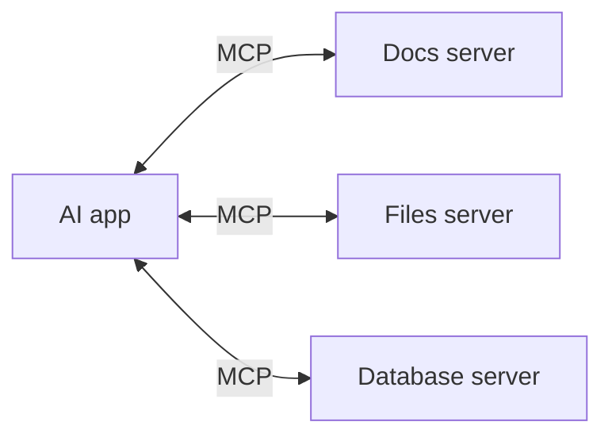
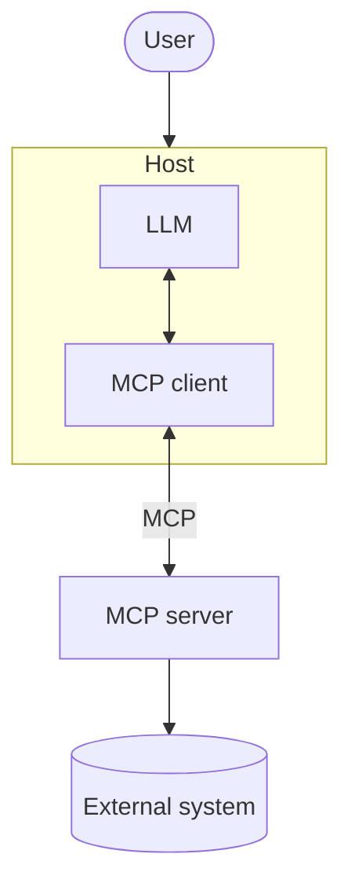
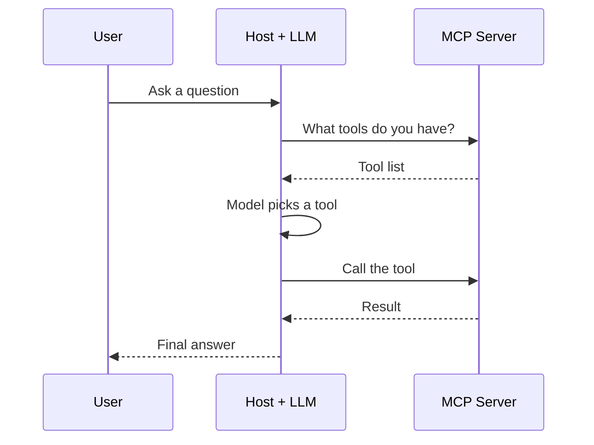

# What Is MCP?

> **Model Context Protocol (MCP)** is an open standard that lets AI applications connect to external tools, data, and prompts in a common way.

**Reading time:** ~8 minutes

## What does the name mean?

- **Model**: the LLM.
- **Context**: the extra info and abilities the model needs (files, search, databases, actions).
- **Protocol**: an agreed set of message rules, so different programs can talk to each other.

**In one line:** MCP is a shared "plug standard" between AI apps and the things they want to use.

## The big idea

Instead of writing a custom connector for every system, the app speaks one protocol to many servers.

> MCP does not make integration free. Someone still has to build each server, and existing APIs do not become MCP servers automatically.

## The three roles

| Role | What it is |
|---|---|
| **Host** | The AI app the user uses (IDE assistant, chat app). It runs the LLM. |
| **Client** | A part inside the host. Each client connects to one server. |
| **Server** | A program that exposes capabilities and talks to an external system. |

Key points:
- The host contains the client.
- MCP covers only the **client ↔ server** link.
- The LLM is **not** part of the server.

## The three building blocks

| Primitive | Meaning | Example |
|---|---|---|
| **Tool** | An action that can be called | `search_docs(query)` |
| **Resource** | Data to read as context | `file:///project/main.py` |
| **Prompt** | A reusable prompt template | `code_review` |

Tools are usually proposed by the model. Resources and prompts are often chosen by the app or user, so they don't all behave the same way.

## How a tool call works (simple version)

The model only **proposes** the call. The host runs it through the client, and the server does the work. This is a simplified example, not the only possible flow.

## What MCP is and is not

| MCP is | MCP is not |
|---|---|
| A communication standard | An LLM |
| A way to discover and call capabilities | An agent or planner |
| Separate from REST APIs | A replacement for REST APIs, function calling, or agent frameworks |

MCP works alongside all three.

## Summary

- MCP standardizes how AI apps reach tools, data, and prompts.
- Host runs the model, client connects, server exposes capabilities.
- Three building blocks: tools, resources, prompts.
- MCP does no reasoning. The LLM reasons; MCP carries the messages.

## Quick check

1. What problem does MCP solve?
2. What is the difference between host, client, and server?
3. Does MCP do the model's reasoning?
4. Is "read a file" more like a tool or a resource?

Answers

1. Every app needing its own custom connector for every system.
2. Host = the AI app; client = connector inside it for one server; server = exposes capabilities.
3. No. The LLM reasons.
4. A resource (data to read). Something that changes state would be a tool.

## References

- https://modelcontextprotocol.io/docs/learn/architecture
- https://modelcontextprotocol.io/specification/latest