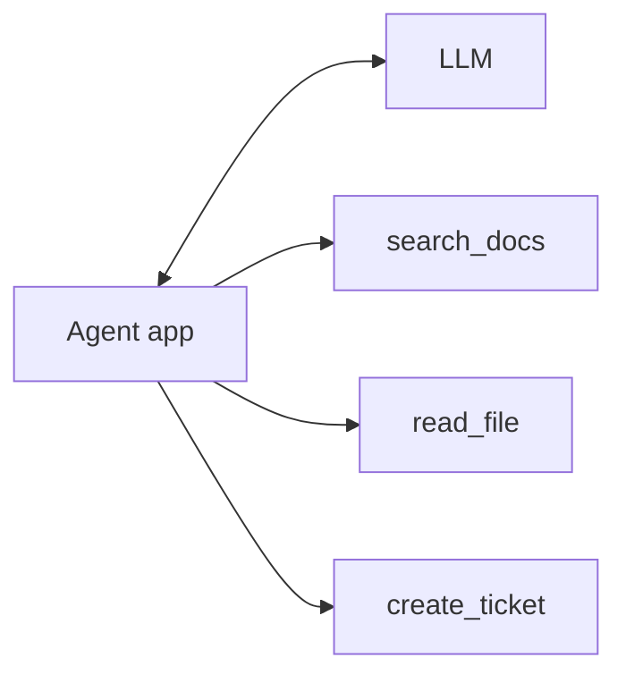
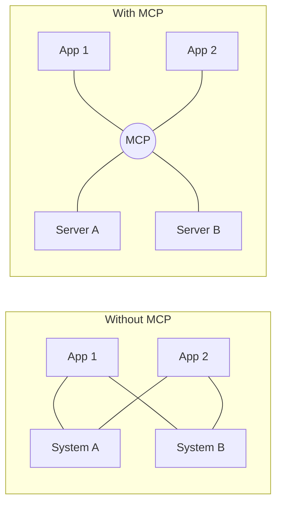
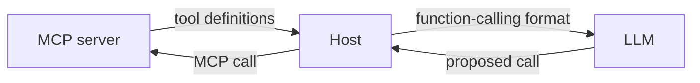

# Why MCP?

> You already know function calling and agents. So why add MCP?

**Reading time:** ~7 minutes

## Where you are now

Your tools are Python functions inside your app. This works, until you have more than one app.

## The problems

**1. Tools are stuck inside one app.**
A tool written for one framework can't be used by another app without rewriting it.

**2. Too many connectors (the N×M problem).**
With N apps and M systems, you may need up to N×M custom connectors.

With MCP, each app builds one client and each system builds one server. This reduces duplicated work, but servers still have to be built.

**3. Tool lists are hard-coded.**
Adding a tool means changing app code. With MCP, the client can ask a server what it offers at runtime.

**4. Mixed responsibilities.**
Without a standard, the team that owns a system also writes the AI glue for every app. With MCP, the system owner builds a server and app builders just connect to it.

**5. Tools run inside your app.**
A buggy in-process tool can affect the whole app. An MCP server is a separate program with its own boundary. This helps, but MCP does not make servers safe by itself.

## Before and after

| | Without MCP | With MCP |
|---|---|---|
| Docs search for 3 apps | 3 integrations | 1 server |
| Update search logic | Change 3 codebases | Change the server |
| Add a new app | Write a new integration | Connect the existing server |

## MCP and function calling

They work together, not against each other:

MCP supplies and runs the tools. Function calling is how the model asks for them.

## When you may not need MCP

- One app with a few simple tools you won't reuse.
- A quick one-off script.
- You can't yet vet or secure the servers.

## Summary

- Tools in one app can't easily be reused elsewhere.
- MCP cuts duplicate work, allows runtime discovery, and separates who builds servers from who builds apps.
- It works alongside function calling and agents.
- Small, single-app projects often don't need it.

## Quick check

1. What is the N×M problem?
2. Why is runtime discovery useful?
3. Does MCP replace function calling?
4. Name one case where you wouldn't use MCP.

Answers

1. N apps and M systems can need up to N×M custom connectors.
2. The app can learn about new tools without code changes.
3. No. They cooperate.
4. A single app with a few simple tools and no reuse.

## References

- https://modelcontextprotocol.io/docs/learn/architecture