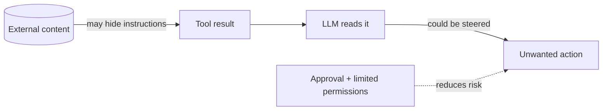
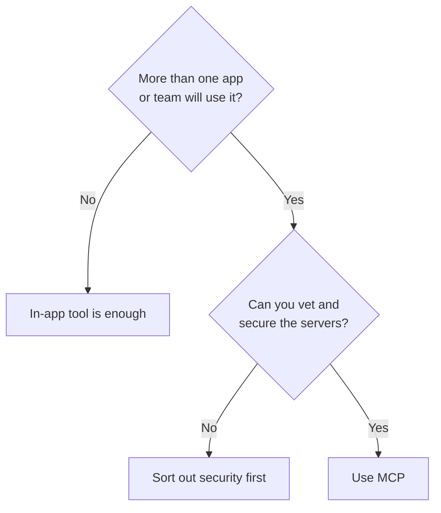

# Advantages, Limitations, and Alternatives

> What do you gain, what do you pay, and what else could you use?

**Reading time:** ~8 minutes

## Advantages

| Advantage | In simple words |
|---|---|
| **Reuse** | Build a connector once, use it in many apps |
| **Discovery** | The app asks the server what it can do |
| **Separation** | System owners build servers; app builders build apps |
| **Language neutral** | A Python server can serve a TypeScript client |
| **Isolation** | Servers run behind a separate boundary |
| **Uniform pattern** | Tools, resources, and prompts use one style |

## Limitations

| Limitation | What it means |
|---|---|
| **Security is not automatic** | You must trust and vet servers, limit permissions, ask for approval on risky actions |
| **Prompt injection** | Text in tool results (web pages, files) can try to steer the model |
| **Too many tools** | Each tool definition uses context and can confuse the model |
| **Extra complexity** | One more component to run and debug |
| **Uneven quality** | Some servers are better built than others |
| **No smarter model** | MCP gives access, not better reasoning |
| **Evolving standard** | Check current docs; not every host supports every feature |

Treat tool output as untrusted input. Give servers only the access they need.

## Alternatives

Most of these work **with** MCP rather than replacing it.

| Option | What it does | Relation to MCP |
|---|---|---|
| **Direct API/SDK calls** | Your code calls a service itself | An MCP server can wrap it |
| **Function calling** | Model proposes a function call | Used together with MCP |
| **Framework tools** | Tools inside one agent framework | Frameworks may support MCP servers |
| **Vendor plugins** | Integrations for one product | Tied to that vendor; MCP aims to be neutral |
| **Agent-to-agent protocols** | Agents talk to other agents | Different focus; generally complementary |

## Should you use MCP?

Rule of thumb: start simple, move to MCP when reuse or separation justifies it.

## Summary

- Gains: reuse, discovery, separation, language neutrality.
- Costs: security work, extra complexity, possible tool overload.
- Alternatives mostly complement MCP.
- Use MCP when several apps or teams share a capability and you can secure it.

**Foundation complete.** Next: internals and architecture.

## Quick check

1. Name two advantages and why they exist.
2. Why is prompt injection a risk even with an honest server?
3. Can function calling and MCP be used together?
4. When is an in-app tool enough?

Answers

1. e.g. Reuse (standard messages) and discovery (tools listed at runtime).
2. The server may fetch content written by someone else that contains instructions.
3. Yes. The host converts MCP tool definitions into the model's tool format.
4. When only one app uses it and no isolation is needed.

## References

- https://modelcontextprotocol.io/docs/learn/architecture
- https://modelcontextprotocol.io/specification/latest