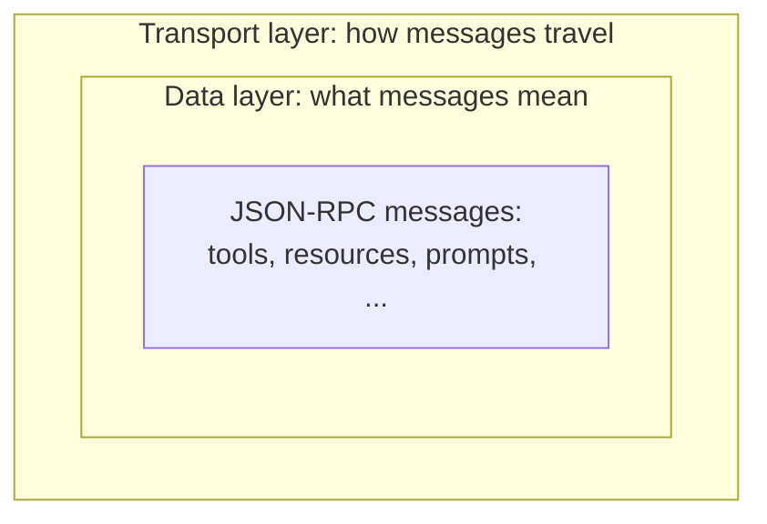
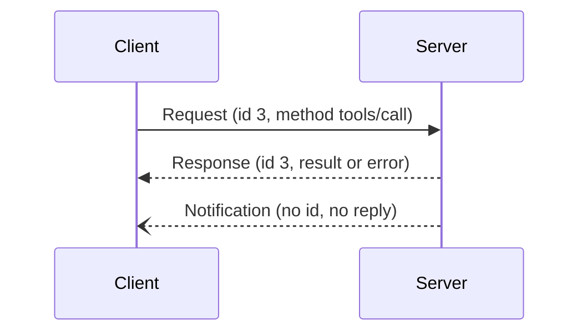

# Protocol Layers and JSON-RPC

> How is MCP built underneath? Two layers, and one message format.

**Reading time:** ~8 minutes

## Two layers

| Layer | Job | Examples |
|---|---|---|
| **Data layer** (inner) | *What* is said: message structure and meaning | tools, resources, prompts, discovery, notifications |
| **Transport layer** (outer) | *How* messages travel: connection, framing, authentication | stdio, Streamable HTTP |



The same data-layer messages work over any transport. That is why a server can switch from local to remote without changing what it exposes.

## JSON-RPC 2.0 in plain words

**JSON-RPC** is a simple standard for calling a named method on another program using JSON. MCP uses it for all messages. There are three message kinds:

| Kind | Has `id`? | Expects reply? | Use |
|---|---|---|---|
| **Request** | Yes | Yes | "Do this and tell me the result" |
| **Response** | Same `id` as request | n/a | Result or error |
| **Notification** | No | No | "FYI, something happened" |

A request:

```json
{
  "jsonrpc": "2.0",
  "id": 3,
  "method": "tools/call",
  "params": { "name": "weather_current", "arguments": { "location": "Lahore" } }
}
```

A successful response (same `id`):

```json
{
  "jsonrpc": "2.0",
  "id": 3,
  "result": { "content": [ { "type": "text", "text": "34°C, clear" } ] }
}
```

An error response has an `error` field (with a code and message) instead of `result`.



The `id` is how a client matches a response to its request.

## Method names follow a pattern

| Pattern | Meaning | Example |
|---|---|---|
| `*/list` | Discover what exists | `tools/list` |
| `*/get` or `*/read` | Fetch one item | `prompts/get`, `resources/read` |
| `tools/call` | Run a tool | `tools/call` |
| `notifications/...` | One-way updates | `notifications/tools/list_changed` |

## Why this design is helpful

- JSON-RPC is simple, language-neutral, and easy to log and debug.
- Because messages are plain JSON, SDKs in any language can implement them.
- Separating layers lets transports evolve independently.

## Summary

- Data layer = meaning of messages; transport layer = delivery.
- All messages are JSON-RPC 2.0: requests, responses, notifications.
- Methods follow readable patterns like `tools/list` and `tools/call`.

## Quick check

1. What is the difference between the data layer and transport layer?
2. How does a client match a response to its request?
3. What is special about a notification?
4. What does `*/list` do?

<details>
<summary>Answers</summary>

1. Data layer defines message content and meaning; transport layer carries the messages.
2. By the matching `id`.
3. It has no `id` and no response is expected.
4. Lets the client discover what items of that kind the server offers.

</details>

## References

- https://modelcontextprotocol.io/docs/learn/architecture
- https://modelcontextprotocol.io/specification/latest