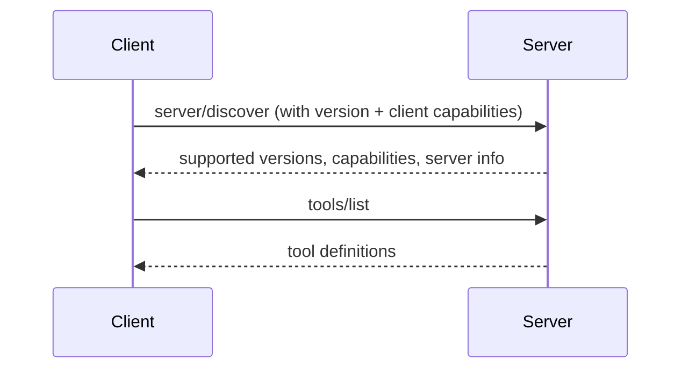

# Discovery, Capabilities, and Versions

> Before using a server, how does a client know what it supports?

**Reading time:** ~8 minutes

## Three things must be known

| Question | Answer comes from |
|---|---|
| Which **protocol version** do we both speak? | Version fields in the messages |
| Which **capabilities** does each side support? | Capability objects |
| **Who** is on the other end? | Client/server info (name, version) for debugging |

A **capability** is a feature a side supports, such as tools, resources, prompts, or elicitation. Declaring capabilities means unsupported operations are never attempted.

## Current spec: stateless requests plus discovery

In the current specification (version `2026-07-28`), MCP is **stateless**: every request carries what the server needs to process it, so the server does not rely on earlier requests.

- Each request includes the protocol version and the client's capabilities in its `_meta` field. Clients should also include their identity.
- Servers advertise their supported versions, capabilities, and identity through the `server/discover` request, which servers must implement.
- Calling `server/discover` first is **optional**. A client may send any request directly and handle a version error if one comes back.
- Discovery responses can be cached (hints like `ttlMs`).



Example server capabilities:

```json
{ "tools": { "listChanged": true }, "resources": {} }
```

Meaning: the server supports tools (and can announce when the tool list changes) and supports resources.

## Version mismatch

If the server doesn't support the version the client asked for, it rejects the request and lists the versions it does support. The client then retries with a version both sides support.

## You may also see the older "initialize" handshake

Earlier protocol versions began each connection with an **initialize** handshake: the client sent `initialize` with its version and capabilities, the server replied with its own, and the client confirmed with an `initialized` notification. The goal was the same, which is agreeing on version and capabilities, but the connection was **stateful**. Many existing servers and SDKs use these older versions, so expect to see both styles. Check which version your SDK and server speak.

| | Older style | Current spec |
|---|---|---|
| Setup | `initialize` handshake per connection | Version and capabilities on every request; optional `server/discover` |
| State | Connection state matters | Stateless requests |

## Extensions

Beyond the core protocol, optional **extensions** (for example Tasks for long-running work) are opt-in and need support from both sides.

## Summary

- Both sides must know version, capabilities, and identity.
- Current spec: stateless requests carry this info; `server/discover` fetches it.
- Older spec: an `initialize` handshake did the same job.
- Capabilities prevent unsupported calls.

## Quick check

1. What is a capability?
2. Why is MCP in the current spec called stateless?
3. What happens on a version mismatch?
4. How did older versions negotiate capabilities?

<details>
<summary>Answers</summary>

1. A feature a client or server supports (tools, resources, prompts, elicitation, ...).
2. Each request carries everything needed to process it.
3. The server rejects with the versions it supports; the client retries with a compatible one.
4. With an `initialize` request/response followed by an `initialized` notification.

</details>

## References

- https://modelcontextprotocol.io/docs/learn/architecture
- https://modelcontextprotocol.io/specification/latest