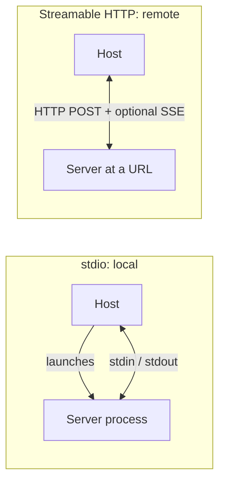

# Transports: stdio and Streamable HTTP

> How do messages physically travel between client and server?

**Reading time:** ~7 minutes

MCP defines two transports. Both carry the same JSON-RPC messages.

## Comparison

| | **stdio** | **Streamable HTTP** |
|---|---|---|
| Where the server runs | Same machine as the client | Usually remote (can also be local) |
| How it connects | Host launches the server as a child process | Client connects to a server URL |
| Channel | Standard input/output streams | HTTP POST, with optional Server-Sent Events (SSE) for streaming |
| Typical clients per server | Usually one | Usually many |
| Authentication | Environment/OS-level, no network | Standard HTTP auth (bearer tokens, API keys, headers); OAuth recommended |
| Overhead | Very low, no network | Network latency |

## stdio in practice

- The host starts the server program and talks to it through its standard input and output.
- Messages must be the protocol's JSON-RPC only on the server's stdout. Printing anything else there can break communication.
- For debug output, write to **stderr**.

## Streamable HTTP in practice

- The client sends messages with HTTP POST.
- The server can reply normally or stream results using Server-Sent Events, which is useful for long or incremental responses.
- Because it is standard HTTP, you can use familiar tools: load balancers, headers, and token-based authentication.

## "Local" vs "remote" is about transport, not code

**MCP server** means the program serving context, wherever it runs. Local servers typically use stdio; remote servers typically use Streamable HTTP.

## Choosing

| Situation | Likely choice |
|---|---|
| Personal tool on your laptop (files, git) | stdio |
| Shared service for a team or many users | Streamable HTTP |
| Needs per-user authorization | Streamable HTTP with OAuth |

## Summary

- Two transports: stdio (local process) and Streamable HTTP (network).
- The message format is identical over both.
- stdout is for protocol messages on stdio; log to stderr.
- Remote servers use standard HTTP authentication.

## Quick check

1. Which transport suits a local file-access server, and why?
2. Why must a stdio server avoid printing random text to stdout?
3. What does SSE add to Streamable HTTP?
4. Does changing transport change what tools a server exposes?

Answers

1. stdio: no network overhead, launched as a local process.
2. stdout carries the protocol messages; extra text can corrupt them.
3. Streaming of responses from the server.
4. No. Transport only changes delivery.

## References

- https://modelcontextprotocol.io/docs/learn/architecture
- https://modelcontextprotocol.io/specification/latest