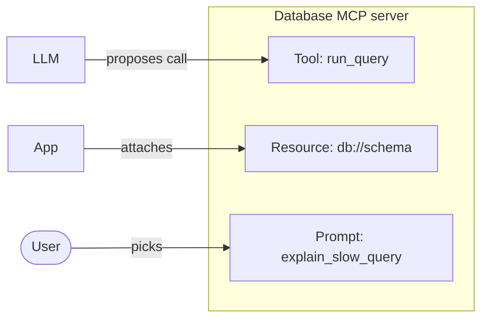

# Tools, Resources, and Prompts in Depth

> A closer look at each server primitive: what it contains and how it is used.

**Reading time:** ~10 minutes

## Who controls each one?

| Primitive | Meant for | Typical control |
|---|---|---|
| **Tools** | Functions for the AI model to execute | Model proposes, host asks consent |
| **Resources** | Context and data for the user or model | Application or user selects |
| **Prompts** | Templated messages and workflows for users | User chooses (e.g. a menu or command) |

Each has discovery methods: `tools/list`, `resources/list`, `prompts/list`.

## Tools

A tool listing has:

| Field | Purpose |
|---|---|
| `name` | Unique ID within the server; used in `tools/call` |
| `title` | Human-friendly display name |
| `description` | Tells the model what the tool does and when to use it |
| `inputSchema` | JSON Schema describing the arguments |

```json
{
  "name": "search_docs",
  "description": "Search project documentation by keyword",
  "inputSchema": {
    "type": "object",
    "properties": { "query": { "type": "string" } },
    "required": ["query"]
  }
}
```

Calling it (`tools/call`) returns a `content` array. Items have a `type`, such as text. The server should **validate** the arguments against the schema before running anything.

**Two kinds of failure**

| Kind | Example |
|---|---|
| Protocol error | Unknown tool, malformed request |
| Tool execution error | The tool ran but failed (e.g. API timeout); reported in the result so the model can react |

**Good descriptions matter.** The model reads them to decide when to call the tool, so vague descriptions lead to wrong calls.

## Resources

Resources are data identified by a **URI**, such as `file:///project/README.md` or `db://schema/users`.

- `resources/list`: see what is available.
- `resources/read`: fetch the contents.
- Servers can also describe **templates**, patterns like `file:///{path}`, for resources with parameters.

Use a resource when the thing is *data to read*, with no side effects: files, schemas, documents.

## Prompts

A prompt is a reusable template a server offers, optionally with arguments.

- `prompts/list`: see available prompts and their arguments.
- `prompts/get`: fetch the filled-in messages.

Example: a `code_review` prompt that takes a file name and returns messages instructing the model how to review that file. The user typically picks it, much like a slash command.

## How they fit together



One server can offer all three. For a database server: a tool to run queries, a resource holding the schema, and a prompt with guidance for using them.

## Tool or resource?

| Question | Answer → |
|---|---|
| Does it do something or change state? | Tool |
| Is it computed from parameters on demand? | Usually tool |
| Is it data to read as context? | Resource |
| Is it a reusable instruction pattern? | Prompt |

## Summary

- Tools = actions with a name, description, and input schema.
- Resources = data addressed by URI, read with `resources/read`.
- Prompts = reusable templates fetched with `prompts/get`.
- They differ in who triggers them, so don't treat them identically.
- Tool errors can be protocol errors or execution errors.

## Quick check

1. What does `inputSchema` do?
2. Which primitive would expose a project's database schema, and why?
3. Why do tool descriptions matter?
4. Who typically triggers a prompt?

<details>
<summary>Answers</summary>

1. Describes and constrains the arguments so the model and server agree on input shape.
2. A resource: it's data to read as context.
3. The model uses them to decide when and how to call the tool.
4. The user.

</details>

## References

- https://modelcontextprotocol.io/docs/learn/architecture
- https://modelcontextprotocol.io/specification/latest