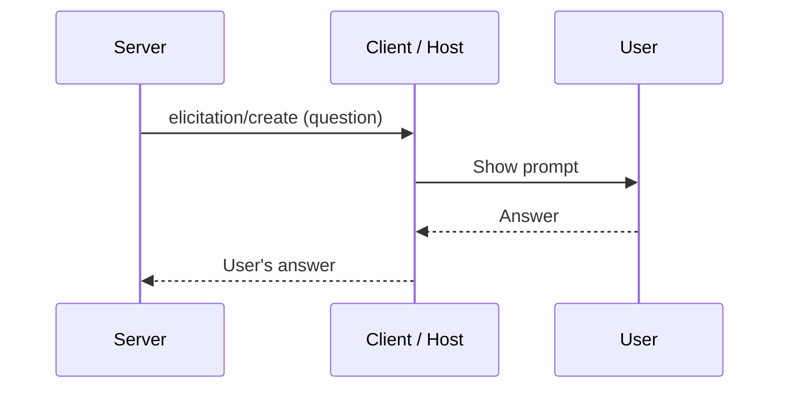
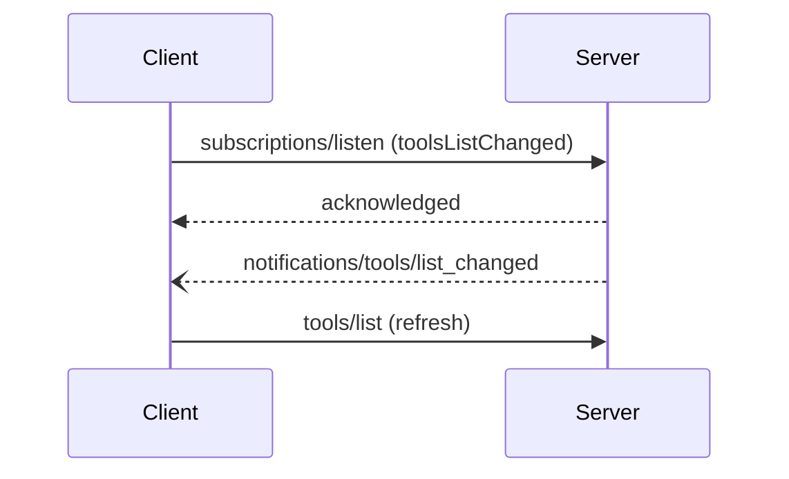

# Client Features, Notifications, and Long-Running Work

> Communication isn't only client → server. Servers sometimes need things back, and clients need to hear about changes.

**Reading time:** ~8 minutes

## Elicitation: the server asks the user

**Elicitation** lets a server request extra input or confirmation from the user through the client.

Example: a "deploy" tool asks "Deploy to production? yes/no" before proceeding.

The client declares it supports elicitation as a capability, so servers only ask if it can.

## Sampling and logging (now deprecated)

Earlier protocol versions let servers request model completions from the client (**sampling**) and send log messages to clients (**logging**). As of version `2026-07-28` both are **deprecated**. For new work the docs suggest calling an LLM provider directly instead of sampling, and logging to `stderr` (stdio) or using OpenTelemetry. You may still meet these in older material.

## Notifications: staying up to date

Server capabilities can change (a tool is added, a resource changes). A **notification** is a one-way message that says so.

In the current spec, notifications are **opt-in**:

1. The client opens a long-lived stream with `subscriptions/listen`, naming the notification types it wants (for example tool-list changes).
2. The server acknowledges which ones it will honor.
3. When something changes, it sends e.g. `notifications/tools/list_changed`.
4. The client reacts by re-requesting `tools/list`.

Delivery is **best effort**, so clients should also refresh periodically rather than trusting every notification to arrive.

## Utilities

| Utility | Purpose |
|---|---|
| **Progress tracking** | Report how far a long operation has got |
| **Cancellation** | Stop a request that is no longer needed |
| **Error reporting** | Consistent way to signal problems |
| **Caching hints** | Let clients reuse responses for a while (e.g. `ttlMs`) |

## Long-running work: Tasks extension

Some operations take too long to wait for. The optional **Tasks** extension lets a server return a durable handle so the client can check status later and fetch the result. Extensions are opt-in and need support from both sides.

## Summary

- Elicitation lets servers ask the user via the client.
- Sampling and logging are deprecated in the current spec.
- Notifications keep clients current; they are opt-in and best effort.
- Utilities cover progress, cancellation, errors, caching.
- Tasks is an optional extension for long-running operations.

## Quick check

1. What is elicitation, and who ultimately answers?
2. Why shouldn't a client rely only on notifications?
3. What does a client usually do after `list_changed`?
4. Why do extensions need both sides to support them?

Answers

1. A server asking for more input or confirmation; the user answers through the client.
2. Delivery is best effort and may be missed, especially across reconnects.
3. Calls `tools/list` again.
4. They are optional additions that only work if both sides understand them.

## References

- https://modelcontextprotocol.io/docs/learn/architecture
- https://modelcontextprotocol.io/specification/latest