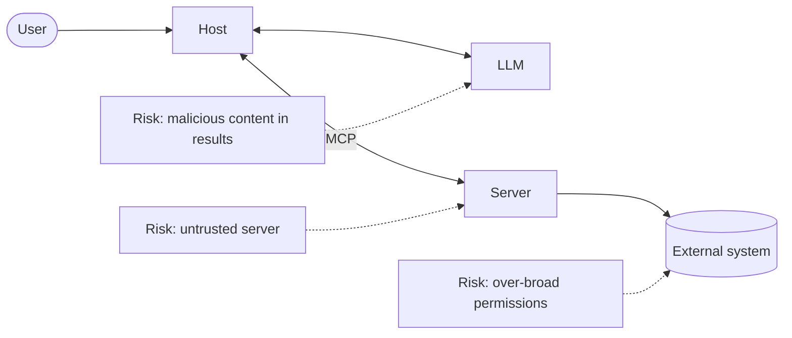

# Security and Trust Basics

> MCP gives models access to data and actions. That power needs care.

**Reading time:** ~8 minutes

## The core idea

MCP itself **cannot enforce** security at the protocol level. The specification lists principles that hosts and server authors are expected to build in.

## Key principles from the specification

| Principle | Meaning |
|---|---|
| **User consent and control** | Users must understand and agree to data access and actions |
| **Data privacy** | Hosts get explicit consent before exposing user data to servers, and don't send resource data elsewhere without consent |
| **Tool safety** | Tools can run arbitrary code, so treat them with caution and get consent before invoking them |

Tool descriptions and annotations should be considered **untrusted** unless they come from a trusted server.

## Where the risks are

| Risk | Explanation |
|---|---|
| **Untrusted or malicious server** | May misbehave or lie in its descriptions |
| **Prompt injection** | Text in a tool result (a web page, ticket, file) tries to instruct the model |
| **Over-broad access** | A server with too many permissions makes any mistake costly |
| **Leaking data** | Sending private data to a server you don't trust |
| **Credential handling** | Tokens and keys stored or passed carelessly |

## What hosts should do

- Show users what a tool will do and ask for approval for risky actions.
- Connect only to servers you trust and have reviewed.
- Treat tool output as untrusted input, not as instructions.
- Expose only the tools needed for the task.

## What server authors should do

- Validate all tool inputs before acting.
- Request the least access needed.
- Keep secrets out of logs and results.
- Describe tools honestly and precisely.

## Authentication for remote servers

Remote servers using Streamable HTTP can use standard HTTP authentication such as bearer tokens or API keys. The MCP docs recommend using **OAuth** to obtain tokens. Local stdio servers don't use network authentication in the same way and usually rely on the local environment.

## Summary

- MCP does not enforce security; hosts and servers must.
- Core principles: consent, privacy, tool safety.
- Treat tool descriptions and tool output as untrusted unless the server is trusted.
- Use least privilege and validate inputs.
- OAuth is recommended for remote HTTP authentication.

## Quick check

1. Why can't MCP itself guarantee safety?
2. What is prompt injection in this context?
3. Name two things a host should do before calling a tool.
4. Why apply least privilege to servers?

Answers

1. It defines communication, not how hosts and servers handle consent or permissions.
2. Instructions hidden in tool results that try to steer the model.
3. e.g. Show what it will do and get consent; confirm the server is trusted.
4. It limits the damage if a server is compromised or the model is misled.

## References

- https://modelcontextprotocol.io/specification/latest
- https://modelcontextprotocol.io/docs/learn/architecture