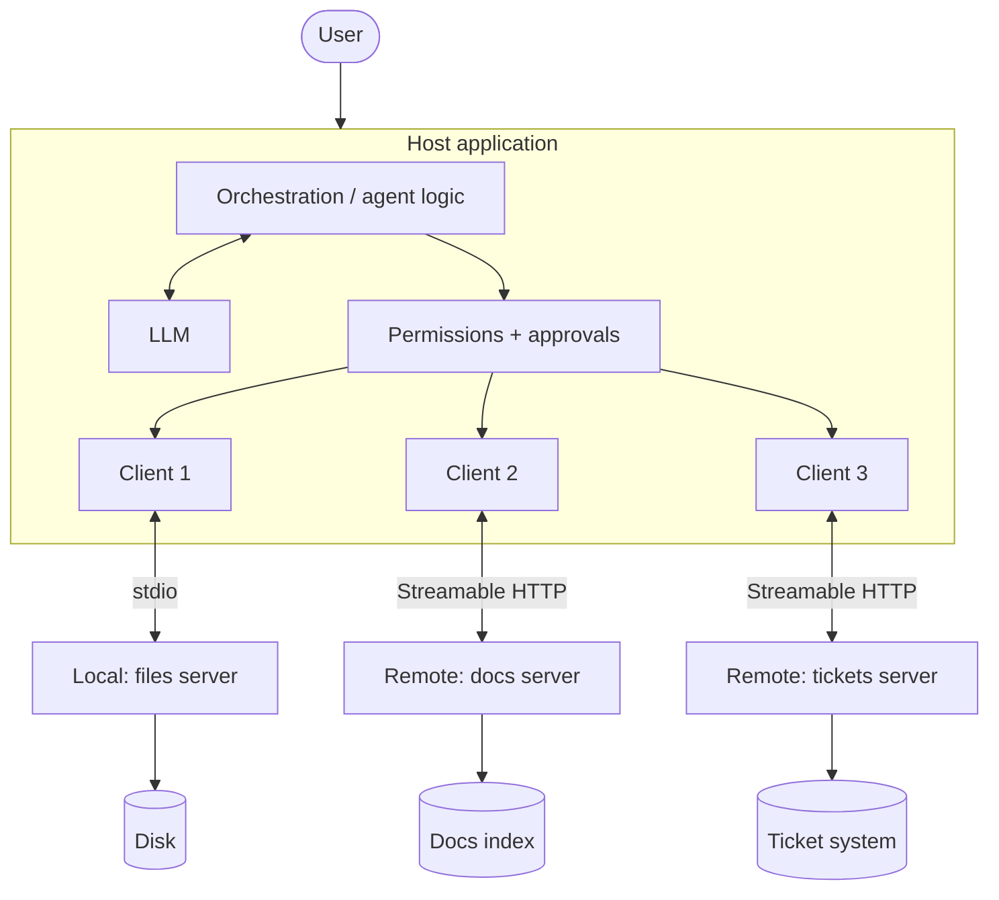
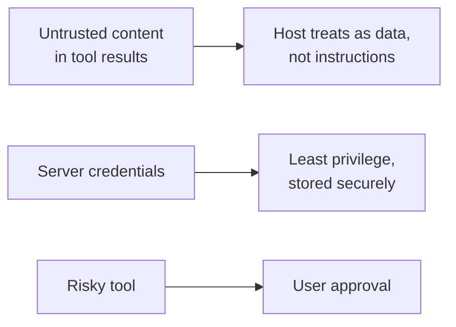

# MCP System Design

> You know the pieces. Now: how do you put them together into a sensible system?

**Reading time:** ~10 minutes

## The system at a glance

Design questions fall into three areas: the **host**, the **servers**, and the **connections** between them.

## 1. Designing servers

### One server per domain

Group related capabilities by system or purpose: a docs server, a tickets server, a filesystem server. This keeps each server small, easier to secure, and owned by one team.

| Avoid | Prefer |
|---|---|
| One giant server doing everything | Several focused servers |
| Many near-identical tools | A few clear tools with good schemas |

### Tool granularity

| Too fine | Too coarse | Balanced |
|---|---|---|
| `get_title`, `get_body`, `get_author` | `do_everything(request)` | `get_ticket(id)`, `search_tickets(query)` |

Guidelines:
- Name tools by the task a user would describe.
- Write precise descriptions: the model reads them to choose tools.
- Use strict input schemas so bad arguments are caught early.
- Return results that are compact and useful to the model, not raw dumps.

### Pick the right primitive

| Need | Use |
|---|---|
| Do something or compute on demand | Tool |
| Provide data to read | Resource |
| Reusable guided workflow for the user | Prompt |

## 2. Designing the host

The host is where most important decisions live.

| Responsibility | Why it matters |
|---|---|
| **Choose which servers to connect** | Each server is a trust decision |
| **Decide which tools the model sees** | Too many tools cost context and confuse selection |
| **Ask for user consent** | Required for tool use and data sharing |
| **Handle failures** | Servers can be slow or down |
| **Combine tools from many servers** | Needs a unified registry and name handling |

### Managing many tools

Every tool definition the model sees uses context. Options:

- Connect only the servers relevant to the task.
- Filter tools per request or per user role.
- Use progressive discovery: load the full tool list only when needed. The MCP client best-practices docs describe this for clients that federate many servers.

### Approval policy

A simple approach is to classify tools by risk:

| Risk | Example | Policy |
|---|---|---|
| Read-only | search docs | Can auto-run if you trust the server |
| Writes | create ticket | Ask the user |
| Destructive or costly | delete, deploy, pay | Always ask, with a clear description |

## 3. Choosing connections

| Factor | stdio (local) | Streamable HTTP (remote) |
|---|---|---|
| Users | One user's machine | Many users |
| Deployment | Installed and launched locally | Hosted service |
| Auth | Local environment | HTTP auth; OAuth recommended |
| Updates | Each user updates | Update once on the server |

Rule of thumb: personal and local data → stdio. Shared or multi-user services → Streamable HTTP.

## 4. Reliability and operations

- **Timeouts and errors:** treat server calls like any network call. Don't let one slow server freeze the host.
- **Caching:** discovery and list responses can carry freshness hints (such as `ttlMs`), so clients can reuse them.
- **Change handling:** subscribe to list-change notifications, but also refresh periodically since delivery is best effort.
- **Long operations:** use progress tracking and cancellation; for very long work, the optional Tasks extension.
- **Observability:** log requests, tool names, durations, and errors. Don't log secrets. Local stdio servers should log to stderr, not stdout.

## 5. Security in the design

- Treat tool descriptions and results as untrusted unless the server is trusted.
- Give each server only the access it needs.
- Keep credentials out of tool results and logs.
- Validate inputs on the server side, not just in the model.

## 6. Worked example: developer assistant

| Piece | Design choice |
|---|---|
| Files server | stdio, read-only resources for project files |
| Docs server | Remote, Streamable HTTP, `search_docs` tool |
| Tickets server | Remote, OAuth, `search_tickets` (read) and `create_ticket` (write, needs approval) |
| Prompts | `code_review` prompt exposed by the project server, picked by the user |
| Host | Shows only relevant tools per task, asks approval for writes, logs all calls |

Request flow: the user picks `code_review` on `auth.py`. The host attaches the file resource, the model proposes `search_docs`, the host runs it through the docs server client, and the model writes the review. If the model proposes `create_ticket`, the host asks the user first.

## 7. Design checklist

1. Is each server focused on one domain?
2. Are tool names, descriptions, and schemas clear and strict?
3. Does each capability use the right primitive?
4. Is the model shown only the tools it needs?
5. Is there an approval policy by risk level?
6. Is the transport suited to local vs shared use?
7. Are timeouts, errors, and refresh handled?
8. Does every server have least-privilege access?

## Summary

- Design around focused servers, clear tools, and the right primitive for each need.
- The host decides trust, tool exposure, approvals, and failure handling.
- Choose stdio for local, Streamable HTTP for shared services.
- Plan for tool overload, best-effort notifications, timeouts, and observability.
- Security comes from host and server design, not from the protocol alone.

## Quick check

1. Why prefer several focused servers over one large server?
2. How can a host avoid overwhelming the model with tools?
3. Give an approval policy for read, write, and destructive tools.
4. When would you choose stdio over Streamable HTTP?
5. Why shouldn't a client rely only on change notifications?

Answers

1. Smaller servers are easier to secure, own, and reuse, and keep each tool set clear.
2. Connect only relevant servers, filter tools per task or user, or use progressive discovery.
3. Read-only may auto-run for trusted servers; writes ask the user; destructive or costly actions always ask with a clear description.
4. For a personal tool on the user's own machine with no need for network access or multi-user auth.
5. Notifications are best effort and may be missed, so periodic refresh keeps lists accurate.

## References

- https://modelcontextprotocol.io/docs/learn/architecture
- https://modelcontextprotocol.io/specification/latest