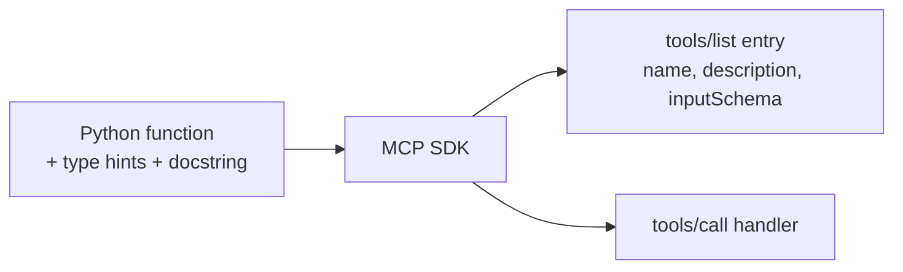

# Build Your Own MCP Server

> Goal: write a small server that exposes a tool and a resource.

**Reading time:** ~4 minutes

## Setup

The official Python SDK needs Python 3.11+.

```bash
uv add "mcp[cli]"
# or: pip install "mcp[cli]"
```

The `[cli]` extra gives you the `mcp` command for development.

## A complete server

From the official SDK docs (v2):

```python
from mcp.server import MCPServer

mcp = MCPServer("Demo")

@mcp.tool()
def add(a: int, b: int) -> int:
    """Add two numbers."""
    return a + b

@mcp.resource("greeting://{name}")
def greeting(name: str) -> str:
    """Greet someone by name."""
    return f"Hello, {name}!"
```

## What the SDK does for you

| You write | SDK handles |
|---|---|
| A function with type hints | The `inputSchema` (JSON Schema) |
| A docstring | The tool `description` the model reads |
| `@mcp.tool()` / `@mcp.resource()` | Listing, calling, validation, JSON-RPC |



## Tips

- Write clear docstrings: the model uses them to choose tools.
- Use precise types. They become your validation rules.
- Older tutorials use `FastMCP` (SDK v1). Check which SDK version you installed.

## Summary

- A server is Python functions plus decorators.
- Type hints become the schema; docstrings become descriptions.
- Next: test it with the Inspector.

## Quick check

1. What generates the tool's input schema?
2. Why do docstrings matter?

<details>
<summary>Answers</summary>

1. The function's type hints, via the SDK.
2. They become the tool description the model reads.

</details>

## References

- https://py.sdk.modelcontextprotocol.io/