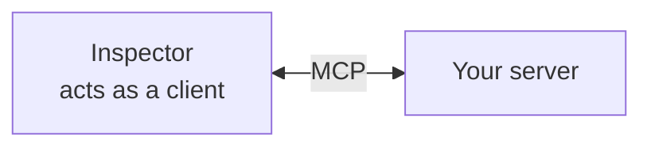

# MCP Inspector

> A visual tool to test a server without an AI app.

**Reading time:** ~3 minutes

## What it is

The **MCP Inspector** is an interactive UI for connecting to an MCP server, listing its tools, resources, and prompts, and calling them by hand.

## Run it

With the Python SDK:

```bash
uv run mcp dev server.py
```

This starts your server and opens the Inspector. It is a Node.js app, so `npx` must be on your `PATH`.

## What to do in it

| Tab | Try |
|---|---|
| **Tools** | Call `add` with `a=1`, `b=2` and check the result |
| **Resources** | Read `greeting://World` |
| **Prompts** | List and fetch prompts, if your server has any |

The form is built from your schema, so a wrong type hint shows up immediately.



## Why use it

- Test without an LLM, so failures are your code and not model behavior.
- See exactly what the server advertises.
- Debug faster than through a full host.

## Summary

- Inspector = manual MCP client for testing.
- Launch with `mcp dev server.py`.
- Test servers here before connecting a real host.

## Quick check

1. Why test with the Inspector before a host?
2. What does the Inspector need installed?

<details>
<summary>Answers</summary>

1. It isolates server problems from model behavior and shows what is advertised.
2. Node.js (`npx`) on your `PATH`.

</details>

## References

- https://py.sdk.modelcontextprotocol.io/
- https://github.com/modelcontextprotocol/inspector