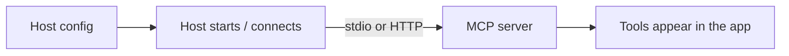

# Integrate an MCP Server into a Host

> Goal: make an AI app (host) use your server.

**Reading time:** ~3 minutes

## The idea

A host needs to know **how to start or reach** each server. Most desktop hosts use a config file listing servers.

## Typical config (stdio)

Many hosts use a JSON file like this:

```json
{
  "mcpServers": {
    "demo": {
      "command": "uv",
      "args": ["run", "mcp", "run", "/path/to/server.py"]
    }
  }
}
```

| Field | Meaning |
|---|---|
| `"demo"` | A name you choose |
| `command` | Program the host launches |
| `args` | Arguments passed to it |

For a remote server (Streamable HTTP), hosts typically take a **URL** instead of a command.

> Config format and file location **differ by host**. Check your host's docs. Use absolute paths for local files.



## Checklist

1. Test the server in the Inspector first.
2. Add it to the host's config.
3. Restart the host.
4. Ask something that needs the tool, then approve the call.

## Common problems

| Symptom | Likely cause |
|---|---|
| Server doesn't appear | Wrong path or command, host not restarted |
| Connects, then breaks (stdio) | Extra text printed to stdout |
| Tool never used | Vague description |

## Summary

- Hosts launch (stdio) or connect to (HTTP) servers from config.
- Formats vary by host.
- Always test in the Inspector first.

## Quick check

1. What does a stdio config entry contain?
2. Why use absolute paths?

<details>
<summary>Answers</summary>

1. A name, a command, and its arguments.
2. The host may launch from a different working directory.

</details>

## References

- https://modelcontextprotocol.io/docs/learn/architecture