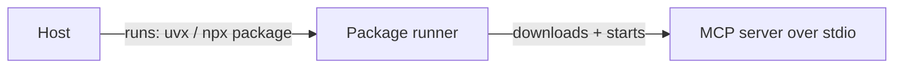

# uvx and npx MCP Servers

> Run published servers without installing them manually.

**Reading time:** ~3 minutes

## The tools

| Tool | Ecosystem | What it does |
|---|---|---|
| **`uvx`** | Python (via `uv`) | Runs a Python package's command in a temporary isolated environment |
| **`npx`** | Node.js | Runs a package from the npm registry, downloading it if needed |

Many published MCP servers are run this way, so the host's config just names the package.

## Host config examples

```json
{
  "mcpServers": {
    "python-server": { "command": "uvx", "args": ["some-mcp-server"] },
    "node-server":   { "command": "npx",  "args": ["-y", "some-mcp-server"] }
  }
}
```

`-y` tells `npx` to proceed without asking for confirmation. Package names here are placeholders.



## Pros and cons

| Pros | Cons |
|---|---|
| No manual install steps | Needs `uv` or Node.js on the machine |
| Easy to share one config line | First run downloads code |
| Easy updates | Runs third-party code on your machine |

## Safety

You are executing someone else's package, locally, often with access to your files. Only run packages you trust, and prefer pinning versions where you can.

## Summary

- `uvx` runs Python packages; `npx` runs npm packages.
- Config names the command and package.
- Treat them as untrusted code unless vetted.

## Quick check

1. What do `uvx` and `npx` do?
2. What is the main security concern?

<details>
<summary>Answers</summary>

1. Download and run a package's command without a manual install.
2. You are running third-party code locally.

</details>

## References

- https://modelcontextprotocol.io/docs/learn/architecture