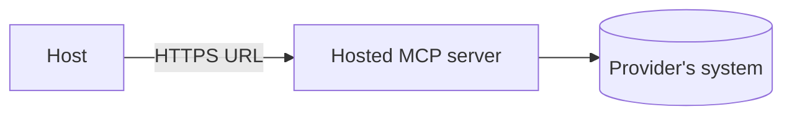

# Hosted (Remote) MCP Servers

> Servers that run on someone's infrastructure and are reached over the network.

**Reading time:** ~3 minutes

## What it is

A **hosted** or **remote** MCP server runs on a service you reach by URL, using the **Streamable HTTP** transport. You don't install or run it yourself.

## Local vs hosted

| | Local (stdio) | Hosted (Streamable HTTP) |
|---|---|---|
| Runs | On your machine | On a server |
| Setup | Install and launch | Add a URL |
| Users | Usually one | Many |
| Auth | Local environment | HTTP auth; OAuth recommended |
| Updates | You update | Provider updates |

## Considerations

- **Trust:** your requests and data go to the provider.
- **Authentication:** usually tokens or OAuth sign-in.
- **Availability:** depends on the provider's uptime and network.
- **Scale:** one deployment can serve many clients.

Hosts differ in how they add a remote URL, so check your host's docs.

## Summary

- Hosted server = remote, Streamable HTTP, added by URL.
- Easier setup and shared updates; requires trusting the provider and handling auth.

## Quick check

1. Which transport do hosted servers typically use?
2. Name one trade-off versus a local server.

Answers

1. Streamable HTTP.
2. Your data goes to the provider, and you depend on its availability.

## References

- https://modelcontextprotocol.io/docs/learn/architecture