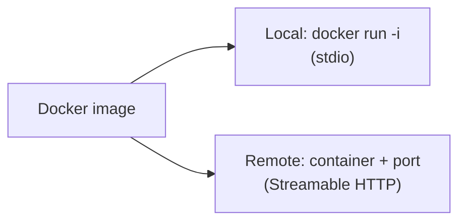

# Deploy an MCP Server with Docker

> Package the server and its dependencies into a container.

**Reading time:** ~4 minutes

## Why Docker

| Benefit | Meaning |
|---|---|
| Consistent environment | Same dependencies everywhere |
| Isolation | The server runs in a container, with only the access you give it |
| Easy deploy | One image runs locally or in the cloud |

## Minimal Dockerfile

```dockerfile
FROM python:3.12-slim
WORKDIR /app
COPY . .
RUN pip install --no-cache-dir .
CMD ["my-mcp-server"]
```

Build it:

```bash
docker build -t my-mcp-server .
```

## Two ways to run

**stdio (local):** the host runs the container and talks through its input/output.

```json
{
  "mcpServers": {
    "mine": {
      "command": "docker",
      "args": ["run", "-i", "--rm", "my-mcp-server"]
    }
  }
}
```

`-i` keeps stdin open; `--rm` removes the container afterwards.

**Streamable HTTP (remote):** run the server in HTTP mode, expose a port, and deploy the image to a host or cloud service.

```bash
docker run -p 8000:8000 my-mcp-server
```



## Tips

- Pass secrets as environment variables, not inside the image.
- Mount only the folders the server needs.
- Use a small base image and pin versions.

## Summary

- Docker gives repeatable, isolated deployments.
- stdio needs `docker run -i`; HTTP needs an exposed port.
- Keep secrets and mounts minimal.

## Quick check

1. Why does stdio in Docker need `-i`?
2. Why mount only needed folders?

<details>
<summary>Answers</summary>

1. The host communicates through stdin, which must stay open.
2. Limits what the server can access if something goes wrong.

</details>

## References

- https://modelcontextprotocol.io/docs/learn/architecture