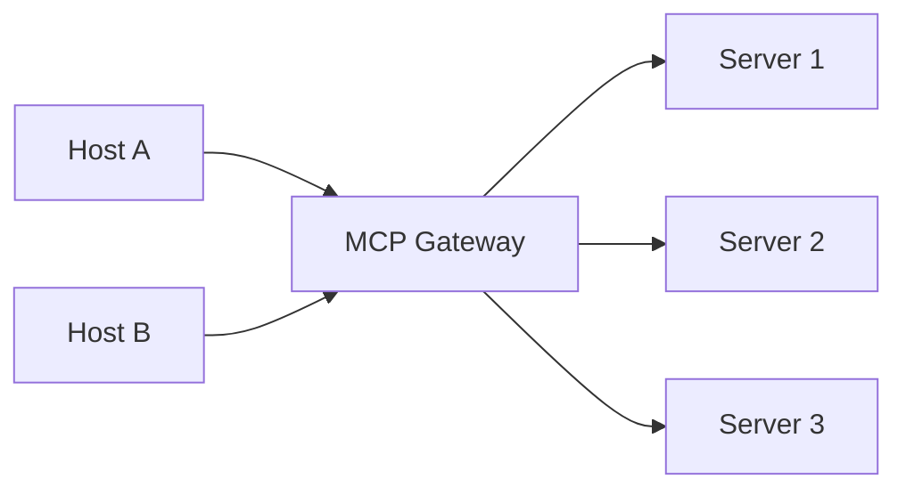

# MCP Gateway

> A single entry point in front of many MCP servers.

**Reading time:** ~3 minutes

**Note:** "MCP gateway" is a design pattern. The core MCP spec doesn't define one, and products vary. Check any specific tool's docs.

## The problem

With many servers, every host must configure each one, handle each server's auth, and manage many connections.

## The idea

The gateway presents one MCP endpoint to hosts and routes requests to the right server behind it.

## What a gateway can provide

| Feature | Benefit |
|---|---|
| **Single endpoint** | Hosts configure one connection |
| **Central authentication** | One place to manage sign-in and tokens |
| **Access control** | Decide who can use which tools |
| **Logging and auditing** | See all calls in one place |
| **Rate limits** | Protect backend servers |
| **Tool filtering** | Limit what the model sees |

## Trade-offs

- Another component to run and secure.
- A single point of failure and extra latency.
- Everything passes through it, so it must be trusted.

## When useful

Teams or organizations with many servers and users who need central control. For one user with two servers, you likely don't need one.

## Summary

- A gateway is one front door for many servers.
- Benefits: central auth, control, logging.
- Costs: extra component and a critical trust point.

## Quick check

1. What problem does a gateway solve?
2. Name a risk of using one.

Answers

1. Many servers each needing separate configuration, auth, and monitoring.
2. It becomes a single point of failure and trust.

## References

- https://modelcontextprotocol.io/docs/learn/architecture