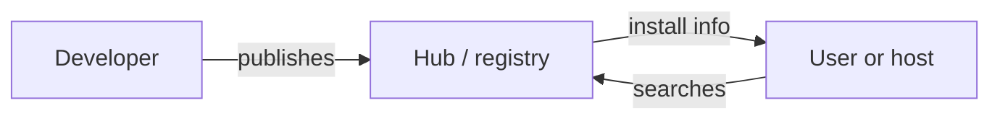

# MCP Hub (Registries and Catalogs)

> Where do you find MCP servers?

**Reading time:** ~3 minutes

**Note:** "MCP hub" is used loosely. It can mean a registry, a catalog, or a tool that manages many servers. Check the specific product for what it means.

## The problem

There are many MCP servers. Finding good ones, and knowing who made them, is hard.

## What a hub offers

| Feature | Benefit |
|---|---|
| **Search / browse** | Discover servers by purpose |
| **Metadata** | Name, description, install command or URL |
| **Publishing** | Developers list their servers |
| **Possibly ratings or verification** | Help judge trust (varies by hub) |

## Two common meanings

| Meaning | Example idea |
|---|---|
| **Registry / catalog** | A directory of servers you can look up |
| **Manager hub** | A tool that runs and organizes several servers for you |

Official and community directories exist. Their features and status change, so check current sources.

## Safety

Listing is not endorsement. Before using a server:

1. Check the author and source code.
2. Review what permissions and data it needs.
3. Prefer pinned versions.
4. Treat its tool descriptions as untrusted until vetted.

## Summary

- A hub helps you find and install servers.
- It may be a registry or a manager.
- Always vet servers before use.

## Quick check

1. What are two things a registry lists?
2. Why isn't being listed proof a server is safe?

Answers

1. e.g. Name/description and how to install or connect.
2. Anyone can publish, and listing doesn't guarantee review.

## References

- https://modelcontextprotocol.io/docs/learn/architecture