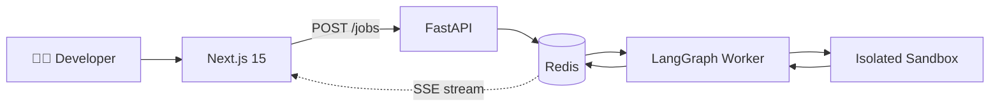
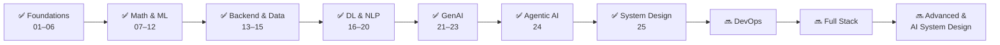

# AI Zero to Hero 🚀

> **The Most Comprehensive Full-Stack AI Engineering Course — Practical, End-to-End, and Continuously Updated.**

**AI Zero to Hero** is a practical, full-stack AI engineering course that takes you from programming fundamentals to building and deploying real-world AI systems — **publicly, daily, and production-focused.**

Unlike traditional courses, this repository is **updated continuously** according to market trends, industry demand, emerging technologies, and new developments in AI — keeping the learning path aligned with what the industry actually hires for.

---

## 📰 Latest News

> **📅 October 15, 2026 — System Design Roadmap Complete! ✅**
>
> **Module 25 (System Design Foundation)** is live: 46 concepts, 16 sandboxes, and 8 phases, from how a web request travels to designing a URL shortener, a news feed, and YouTube.
>
> 🔜 **Up next: DevOps.** After DevOps and Full Stack, the roadmap continues with **Advanced System Design** and **AI System Design**.
>
> 🧪 **Also new:** [TestPilot AI](https://github.com/Sheharyar-Sarmad/TestPilot) is now the latest featured project.

---

## 🌟 Why This Repo

Most AI courses teach theory. This one **ships products.**

Every module ends with something working — code you can run, a project you can deploy, or a system you can demonstrate. Learning is documented publicly through daily commits, LinkedIn posts, and deployed applications.

**Philosophy in one line:**
> Learn the fundamentals. Build practical projects. Ship production-level systems. Adapt continuously.

---

## 📚 Curriculum — 25 Modules (and counting)

### 🧱 Foundations (01–06)
| # | Module | Focus |
|---|---|---|
| 01 | Python Basics | Syntax, control flow, functions, OOP fundamentals |
| 02 | Python Advanced | Decorators, generators, async, context managers |
| 03 | NumPy | Vectorized computation, broadcasting, array ops |
| 04 | Pandas | DataFrames, cleaning, grouping, joins |
| 05 | Seaborn & Matplotlib | Visualization and exploratory data analysis |
| 06 | DSA | Data structures, algorithms, complexity analysis |

### 📐 Math & ML Core (07–12)
| # | Module | Focus |
|---|---|---|
| 07 | Statistics | Descriptive stats, distributions, hypothesis testing |
| 08 | Linear Algebra | Vectors, matrices, eigenvalues, SVD |
| 09 | Machine Learning 1 | EDA, data cleaning, preprocessing, feature selection, feature engineering |
| 10 | Machine Learning 2 | Linear and polynomial regression, gradient descent, cost functions, convergence, MSE, RMSE, R², adjusted R², overfitting, underfitting, regularization |
| 11 | Machine Learning 3 | Logistic regression, Naive Bayes, KNN, SVM, decision trees, ensemble learning, classification metrics, confusion matrix, ROC-AUC, log loss |
| 12 | Machine Learning 4 | Hyperparameter tuning, cross-validation, model evaluation, unsupervised learning, clustering, PCA, dimensionality reduction, curse of dimensionality, pipelines, model deployment |

### 🛠️ Backend & Data Engineering (13–15)
| # | Module | Focus |
|---|---|---|
| 13 | PostgreSQL | Relational modeling, SQL, indexing, transactions |
| 14 | Linux | Shell, processes, permissions, production tooling |
| 15 | FastAPI Overview | REST APIs, endpoints, Pydantic |

### 🧠 Deep Learning & NLP (16–20)
| # | Module | Focus |
|---|---|---|
| 16 | NLP | Tokenization, embeddings, classical NLP pipelines |
| 17 | Deep Learning 1 | Neural networks from scratch, ANN, frontprop, backprop |
| 18 | Deep Learning 2 | CNNs, Layers, Edge Direction |
| 19 | Deep Learning 3 | RNNs, LSTM, GRU, Bidirectional LSTM |
| 20 | Transformers | Architecture, Self-attention |

### 🤖 GenAI & Agentic AI (21–24)
| # | Module | Focus |
|---|---|---|
| 21 | **GenAI Part 1** | Chat models, LangChain, embeddings, structured outputs, **ClipSage capstone** |
| 22 | **GenAI Part 2** | RAG systems, vector DBs, retrieval pipelines |
| 23 | **GenAI Part 3** | Advanced GenAI patterns, fine-tuning, evaluation |
| 24 | **Agentic AI** | Autonomous agents, tool use, multi-agent systems |

### 🏗️ System Design (25) 🆕
| # | Module | Focus |
|---|---|---|
| 25 | **[System Design Foundation](./25_systemdesign_foundation)** | Scaling, caching, databases, messaging, reliability, observability, and interview case studies (46 concepts, 16 sandboxes, 8 phases) |

---

## 🏆 Project of the Week

Every week, one module culminates in a **deployed, production-ready project.**

### 🧪 TestPilot AI — Latest Project 🆕

> **One file. One fix. Verified.**

TestPilot AI turns a failing test and its code context into a proposed patch, verifies it in an isolated sandbox, and streams the full execution lifecycle back to the developer in real time.

**Workflow:** Input → Diagnose → Generate Fix → Sandbox Verify → Retry or Finalize

**Highlights:**
- 🔁 **Cyclic LangGraph workflow** with bounded retries and verification feedback
- 📡 **Live progress via Server-Sent Events (SSE)**
- 📦 **Redis** for job state (JobStore) and event distribution (Pub/Sub EventBus)
- 🛡️ **SSRF protection** and isolated sandbox execution for untrusted code

**Stack:**
- **Backend:** FastAPI, Uvicorn, LangGraph, Redis
- **Frontend:** Next.js 15, TypeScript, Monaco Editor
- **AI:** LLM-powered diagnosis and patch generation

**Live Links:**
- 🌐 **App:** [testpilot-chi.vercel.app](https://testpilot-chi.vercel.app)
- 🔌 **API:** [testpilot-9bs7.onrender.com](https://testpilot-9bs7.onrender.com)
- 💻 **Source:** [github.com/Sheharyar-Sarmad/TestPilot](https://github.com/Sheharyar-Sarmad/TestPilot)



---

### 🎬 ClipSage — Featured Project (Module 21 Capstone)

> **Turn any media into structured notes.**

ClipSage is a full-stack AI media intelligence app that ingests video, audio, images, or URLs and transforms them into structured, queryable knowledge.

**Pipeline:** Ingest → Transcribe → Analyze → Summarize → Sessionize → Interact

**Stack:**
- **Backend:** FastAPI, LangChain, Groq Whisper, ffmpeg, yt-dlp
- **Frontend:** Next.js 14, TypeScript, Tailwind CSS, Shadcn UI, Framer Motion, GSAP
- **AI:** Groq (LLM + Whisper), vision fallback models, Web Speech API

**Live Links:**
- 🌐 **App:** [clipsage-gamma.vercel.app](https://clipsage-gamma.vercel.app)
- 🔌 **API:** [clipsage-1t7l.onrender.com](https://clipsage-1t7l.onrender.com)
- 📖 **Docs:** [clipsage-1t7l.onrender.com/docs](https://clipsage-1t7l.onrender.com/docs)
- 💻 **Source:** [github.com/Sheharyar-Sarmad/ClipSage](https://github.com/Sheharyar-Sarmad/ClipSage)

**Cost:** Built entirely on free tiers — **₨0 to run.**

---

## 🛠️ Full Tech Stack Covered

| Layer | Technologies |
|---|---|
| **Languages** | Python 3.12+, TypeScript, JavaScript, SQL |
| **Data Science** | NumPy, Pandas, Matplotlib, Seaborn, Scikit-learn |
| **Deep Learning** | PyTorch, Hugging Face Transformers |
| **GenAI / LLM** | LangChain, Groq, OpenAI-compatible APIs, Whisper |
| **Backend** | FastAPI, Uvicorn, Pydantic, PostgreSQL, Redis |
| **Frontend** | Next.js, React, Tailwind CSS, Shadcn UI |
| **System Design** | Load balancing, caching, sharding, replication, queues, rate limiting |
| **DevOps** | Linux, Docker (in progress), Vercel, Render |
| **Vector / RAG** | Chroma, embeddings, retrieval chains |
| **Agentic AI** | LangGraph, tool calling, multi-agent orchestration |

---

## 📂 Repository Structure

```text
ai-zero-to-hero/
├── 01_python_basics/
├── 02_python_advance/
├── 03_numpy/
├── 04_pandas/
├── 05_seaborn_&_matplotlib/
├── 06_dsa/
├── 07_statistics/
├── 08_linear_algebra/
├── 09_machine_learning_1/
├── 10_machine_learning_2/
├── 11_machine_learning_3/
├── 12_machine_learning_4/
├── 13_postgreSQL/
├── 14_linux/
├── 15_fastapi_overview/
├── 16_NLP/
├── 17_deep_learning_1/
├── 18_deep_learning_2/
├── 19_deep_learning_3/
├── 20_transformers/
├── 21_genai_1/
├── 22_genai_2/
├── 23_genai_3/
├── 24_agentic_ai/
├── 25_systemdesign_foundation/
├── .gitignore
└── README.md
```

---

## 🚀 How to Use This Repo

### 1. Clone
```bash
git clone https://github.com/Sheharyar-Sarmad/ai-zero-to-hero.git
cd ai-zero-to-hero
```

## 🧭 Navigate to a Module

📦 Each module is self-contained with its own code, notebooks, and mini-projects.

```bash
cd 25_systemdesign_foundation
```

## 🚀 Follow Along

- 📖 Read the module README (where available).
- ▶️ Run the code examples.
- 📝 Complete the exercises.
- 🛠️ Build the module project.

## 📅 Track Progress

This repository is updated **daily**! ⭐ Star it, 🍴 fork it, and follow along publicly as the journey progresses.

---

## 📈 Learning Path



🎯 Each stage builds on the previous one. By the end, you will have built multiple production-grade AI systems.

---

## 🔭 What's Next

1. 🔜 **DevOps:** containers, CI/CD, deployment, and infrastructure
2. 🔜 **Full Stack:** end-to-end application engineering
3. 🔜 **Advanced System Design:** distributed systems and large-scale architectures
4. 🔜 **AI System Design:** LLM serving, RAG at scale, and ML infrastructure

---

## 🤝 Contributing

💡 This is a personal learning journey documented publicly. However, if you spot bugs, have suggestions, or want to share useful resources, contributions are welcome!

1. 🍴 Fork the repository.
2. 🌿 Create a feature branch.
3. 📤 Submit a pull request.

---

## 📬 Connect

- 💻 **GitHub:** [@Sheharyar-Sarmad](https://github.com/Sheharyar-Sarmad)
- 🔗 **LinkedIn:** [Connect and follow my daily updates](https://linkedin.com/in/sheharyar-sarmad/)
- 🌐 **Live Projects:** Explore the TestPilot and ClipSage links above.

---

## ⭐ Support

If this repository helps you, please give it a **star** ⭐ — it keeps the momentum going!

> 🚀 **Learn the fundamentals. Build practical projects. Ship production-level systems. Adapt continuously.**
